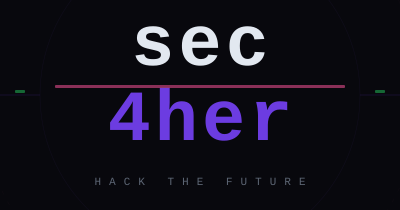

<p align="center">
  
</p>

<h1 align="center">Sec4Her</h1>

<p align="center"><strong><code>&gt; HACK THE FUTURE_</code></strong></p>

**Sec4Her** è una community sulla **cybersecurity fatta da donne, per donne**: uno spazio dove imparare l'hacking
partendo da zero, con una guida, un percorso e senza mai sentirsi sole.

Questo repository contiene la **web app** di Sec4Her. Oggi l'app ha:

- le pagine **Accedi** e **Registrati**, con controlli sui campi;
- una **Home riservata** (`/home`) con header, menu ☰, presentazione dell'Academy e footer;
- la sezione **CTF Groups** (`/ctf`): lista dei CTF, aggiunta di un CTF e gruppi per partecipare insieme
  (con **dati finti** per ora);
- la pagina **Eventi** (`/eventi`) con iscrizione agli eventi e la pagina **Meeting** (`/meeting`) per prenotare
  una call con noi su Cal.com (con **dati finti** per ora);
- una **pagina segnaposto** per le altre voci del menu.

> ⚠️ Il login funziona solo con delle **credenziali di test** e la registrazione **non salva dati**: il
> collegamento a un database per gestire davvero gli account verrà fatto più avanti.

---

## Indice

1. [Tecnologie usate](#1-tecnologie-usate)
2. [Requisiti](#2-requisiti)
3. [Come avviare il progetto in locale](#3-come-avviare-il-progetto-in-locale)
4. [Struttura delle cartelle](#4-struttura-delle-cartelle)
5. [Pagine di Accesso e Registrazione](#5-pagine-di-accesso-e-registrazione)
6. [Login di test, pagine protette ed Esci](#6-login-di-test-pagine-protette-ed-esci)
7. [La pagina Home](#7-la-pagina-home)
8. [CTF Groups](#8-ctf-groups)
9. [Eventi e Meeting](#9-eventi-e-meeting)
10. [Lezioni](#10-lezioni)
11. [I loghi](#11-i-loghi)
12. [Stile e colori del brand](#12-stile-e-colori-del-brand)
13. [Come testare](#13-come-testare)
14. [Come lavoriamo in due](#14-come-lavoriamo-in-due)
15. [Cronologia modifiche](#15-cronologia-modifiche)
16. [Prossimi passi](#16-prossimi-passi)

---

## 1. Tecnologie usate

| Tecnologia | Versione | A cosa serve |
| --- | --- | --- |
| [Next.js](https://nextjs.org) (App Router) | 16 | Il framework del sito: ogni cartella dentro `app/` è un indirizzo (`app/accedi/` → `/accedi`). Avvia l'app in locale, la ricarica a ogni salvataggio e crea la versione da pubblicare (su Vercel). |
| [React](https://react.dev) | 19 | Libreria per costruire l'interfaccia a "componenti" (pezzi riutilizzabili come campi, pulsanti, header). |
| [TypeScript](https://www.typescriptlang.org) | 7 | JavaScript con i **tipi**: segnala molti errori prima ancora di aprire il browser. |
| [Tailwind CSS](https://tailwindcss.com) | 4 | Permette di dare lo stile scrivendo classi direttamente nell'HTML (es. `bg-brand`, `font-mono`). |
| [oxlint](https://oxc.rs) | 1 | Controlla il codice e segnala errori comuni (comando `npm run lint`). |
| [MDX](https://mdxjs.com) (`@next/mdx`) | 3 | Markdown con componenti: il formato del testo delle lezioni (`content/lezioni/`), che arriva dalle note di Obsidian. |

È lo **stack ufficiale** del progetto (vedi `docs/architettura.md`); più avanti si aggiungeranno Supabase e
Stripe. Il codice è scritto in **TypeScript** (file `.ts`, e `.tsx` per i componenti React). Per ora non ci sono
database: il login di test gira tutto nel browser.

---

## 2. Requisiti

Prima di iniziare installa sul computer:

- **[Git](https://git-scm.com/download/win)** – per scaricare il codice e salvare le modifiche.
- **[Node.js](https://nodejs.org)** – versione **20.9 o superiore**, richiesta da Next.js 16.
  Consigliata l'ultima versione **LTS**. Insieme a Node viene installato anche **npm**.
- **[Visual Studio Code](https://code.visualstudio.com)** *(consigliato)* – l'editor per aprire e modificare il codice.

Per controllare che sia tutto installato, apri **PowerShell** e scrivi:

```powershell
git --version
node -v
npm -v
```

Se ognuno risponde con un numero di versione, sei pronta.

---

## 3. Come avviare il progetto in locale

Tutti i comandi vanno scritti in **PowerShell** (oppure nel terminale di VS Code: menu *Terminale → Nuovo terminale*).

**1. Vai nella cartella dei progetti** (se non esiste, creala):

```powershell
New-Item -ItemType Directory -Force C:\Progetti
cd C:\Progetti
```

**2. Clona il repository** (scarica il codice da GitHub):

```powershell
git clone https://github.com/sec4hercommunity/app-sec4her.git
cd app-sec4her
```

**3. Installa le dipendenze** (solo la prima volta, o quando cambia `package.json`):

```powershell
npm install
```

Verrà creata la cartella `node_modules` con tutte le librerie necessarie.

**4. Avvia l'app:**

```powershell
npm run dev
```

**5. Apri il browser** all'indirizzo:

👉 **http://localhost:3000**

Verrai portata automaticamente alla pagina **Accedi**. Entra con le credenziali di test (vedi
[sezione 6](#6-login-di-test-pagine-protette-ed-esci)). Ogni volta che salvi un file, la pagina si aggiorna da sola.

**6. Per fermare l'app** torna nel terminale e premi **`Ctrl + C`**.

### Altri comandi disponibili

Si trovano nella sezione `scripts` di `package.json`:

| Comando | Cosa fa |
| --- | --- |
| `npm run dev` | Avvia l'app in modalità sviluppo su http://localhost:3000. |
| `npm run build` | Crea la versione ottimizzata da pubblicare (cartella `.next/`) e controlla i tipi TypeScript. |
| `npm run start` | Avvia la versione creata con `build`, per controllarla prima di pubblicarla. |
| `npm run lint` | Controlla il codice con oxlint e segnala eventuali errori. |

> 💡 Vuoi provare l'app dal telefono? Con `npm run dev` nel terminale compare anche un indirizzo
> "Network" (es. `http://192.168.x.x:3000`) da aprire sul telefono collegato alla **stessa rete Wi-Fi**.

---

## 4. Struttura delle cartelle

```
app-sec4her/
├── public/                     File statici, serviti così come sono
│   ├── favicon.svg             Iconcina mostrata nella scheda del browser
│   ├── logo.svg                Logo completo originale (Accedi e Registrati)
│   ├── logo-header.svg         Logo ritagliato per l'header: solo "sec", linea cremisi e "4her"
│   └── logo-home.svg           Logo completo ritagliato, senza spazio vuoto (parte centrale della Home)
├── app/                        Le pagine: ogni cartella è un indirizzo (App Router di Next.js)
│   ├── layout.tsx              Cornice di tutto il sito: lingua, titolo, favicon, stili e stato del login
│   ├── globals.css             Importa Tailwind e definisce colori e font del brand
│   ├── page.tsx                /  → manda su /accedi
│   ├── not-found.tsx           Indirizzi che non esistono → manda su /accedi
│   ├── accedi/page.tsx         Pagina di accesso (/accedi)
│   ├── registrati/page.tsx     Pagina di registrazione (/registrati)
│   └── (riservata)/            Pagine che richiedono il login (le parentesi non finiscono nell'indirizzo)
│       ├── layout.tsx          Protezione + struttura: header, contenuto bianco, footer
│       ├── home/page.tsx       Home riservata (/home): logo grande e presentazione dell'Academy
│       ├── ctf/                CTF Groups (sezione 8)
│       │   ├── layout.tsx      Stato condiviso dei CTF + sfondo scuro
│       │   ├── page.tsx        Lista dei CTF (/ctf)
│       │   └── [id]/page.tsx   Dettaglio di un CTF con i gruppi (/ctf/ctf-hunter, …)
│       ├── eventi/             Eventi (sezione 9)
│       │   ├── layout.tsx      Sfondo scuro
│       │   └── page.tsx        Evento del mese, prossimi eventi, eventi passati (/eventi)
│       ├── meeting/            Meeting (sezione 9)
│       │   ├── layout.tsx      Sfondo scuro
│       │   └── page.tsx        Team e call 1:1 da prenotare su Cal.com (/meeting)
│       ├── lezioni/            Lezioni (sezione 10)
│       │   ├── layout.tsx      Stato condiviso (progressi, sessioni live) + sfondo scuro
│       │   ├── page.tsx        Il percorso: mappa dei 7 moduli (/lezioni)
│       │   └── [modulo]/       Pagina del modulo, e [lezione]/ la pagina della lezione
│       └── [sezione]/page.tsx  Pagina segnaposto per le altre voci del menu (/about, /bug-bounty, …)
├── components/                 Pezzi riutilizzati dalle pagine
│   ├── AuthLayout.tsx          Cornice di Accedi/Registrati: logo, slogan, card centrata
│   ├── Campo.tsx               Campo di testo con etichetta e messaggio di errore
│   ├── Pulsante.tsx            Pulsante viola principale
│   ├── Logo.tsx                Mostra un logo; se l'immagine manca mostra la scritta "sec4her"
│   ├── Header.tsx              Barra in alto: logo a sinistra, menu ☰ a destra (con "Esci")
│   ├── Footer.tsx              Barra in basso: Contatti (Email · Instagram · Discord), slogan, copyright
│   ├── IconaDiscord.tsx        Logo di Discord (footer, Eventi, Meeting)
│   ├── RiquadroDiscord.tsx     Riquadro "Unisciti alla community" (in fondo a Eventi e Meeting)
│   ├── Segnaposto.tsx          Contenuto provvisorio delle pagine del menu
│   ├── ctf/                    Pezzi della sezione CTF Groups (card, modali, badge, avatar…)
│   ├── eventi/                 Pezzi della pagina Eventi (card, modale iscrizione, badge, icone…)
│   ├── meeting/                Pezzi della pagina Meeting (card del team e della call)
│   └── lezioni/                Pezzi delle Lezioni (mappa, sessione live, stati) e mdx/ (Callout, Schema, RichiestaHttp)
├── content/
│   └── lezioni/                ✍️ Testo delle lezioni in MDX, una cartella per modulo (sezione 10)
├── auth/
│   ├── AuthProvider.tsx        Stato del login: accedi, esci, utente collegata
│   └── contesto.ts             Hook useAuth() per leggere lo stato del login da qualsiasi pagina
├── config/
│   ├── credenzialiTest.ts      ⚠️ Email, password e nome/cognome dell'utente di TEST (solo sviluppo)
│   ├── links.ts                ⚠️ TUTTI i link esterni (Discord, Cal.com, call): segnaposto da sostituire
│   ├── sito.ts                 Voci del menu e contatti del footer (facili da modificare)
│   └── ctf.ts                  Limiti dei CTF Groups (max gruppi, max membri) e opzioni dei moduli
├── data/
│   ├── ctf-mock.ts             ⚠️ Dati FINTI dei CTF e dei gruppi (da sostituire con Supabase)
│   ├── eventi-mock.ts          ⚠️ Dati FINTI degli eventi (da sostituire con Supabase)
│   ├── meeting-mock.ts         ⚠️ Dati FINTI di team e tipi di call (da sostituire con Supabase)
│   └── lezioni-mock.ts         ⚠️ Dati FINTI: moduli, elenco lezioni, progressi, sessioni live
├── lib/
│   ├── validazione.ts          Regole di controllo dei campi, testi degli errori, controllo dei redirect
│   ├── ctf.ts                  Tipi e regole dei CTF: stato, conto alla rovescia, controlli dei moduli
│   ├── eventi.ts               Tipi e regole degli eventi: temi, piattaforme, posti, conto alla rovescia, controlli
│   ├── meeting.ts              Tipi della pagina Meeting (persona del team, tipo di call)
│   ├── lezioni.ts              Tipi e regole delle Lezioni: stato di moduli e lezioni, proprietà dei file MDX
│   └── ics.ts                  Crea il file .ics "Aggiungi al calendario" direttamente nel browser
├── mdx-components.tsx          Stile del Markdown e componenti usabili nelle lezioni MDX
├── next.config.ts              Configurazione di Next.js (attiva MDX)
├── postcss.config.mjs          Collega Tailwind a Next.js
├── tsconfig.json               Configurazione di TypeScript (es. `@/` = cartella principale negli import)
├── package.json                Nome del progetto, comandi e librerie usate
├── package-lock.json           Versioni esatte delle librerie installate (non modificarlo a mano)
├── .oxlintrc.json              Regole del controllo del codice (oxlint)
├── .gitignore                  File che Git deve ignorare (node_modules, .next, .env.local, prompt.txt, tmpapp/)
├── CLAUDE.md                   Istruzioni per Claude Code: progetto, colori, comandi, regole
├── AGENTS.md                   Note per gli assistenti AI, generate da Next.js (si ricrea con `npm run dev`)
└── docs/
    ├── architettura.md                 Architettura della piattaforma (versione Markdown del PDF)
    ├── struttura-corsi.md              Struttura del percorso formativo (versione Markdown del PDF)
    ├── sec4her-architettura-sito.pdf   Documento originale sull'architettura del sito
    └── sec4her-struttura-corsi.pdf     Documento originale sul percorso formativo
```

---

## 5. Pagine di Accesso e Registrazione

### Quali file

| File | Ruolo |
| --- | --- |
| `app/accedi/page.tsx` | Pagina **Accedi**: campi email e password. |
| `app/registrati/page.tsx` | Pagina **Registrati**: campi nome, email, password e conferma password. |
| `components/AuthLayout.tsx` | Cornice uguale per entrambe le pagine (logo, slogan con cursore lampeggiante, card). |
| `components/Campo.tsx` | Il singolo campo con etichetta e, se serve, il messaggio di errore. |
| `components/Pulsante.tsx` | Il pulsante viola ("Accedi" / "Crea account"). |
| `lib/validazione.ts` | Le regole di controllo dei campi, usate da entrambe le pagine. |

### Come si passa da Accedi a Registrati

Con Next.js gli indirizzi **sono le cartelle** dentro `app/`: non c'è un elenco di rotte da tenere aggiornato.

```
app/page.tsx              →  /            (manda su /accedi)
app/accedi/page.tsx       →  /accedi
app/registrati/page.tsx   →  /registrati
app/not-found.tsx         →  qualsiasi indirizzo che non esiste (manda su /accedi)
```

- Aprendo `/` (o un indirizzo che non esiste) si viene mandate su **`/accedi`**.
- In fondo a ogni pagina c'è un link verso l'altra, senza ricaricare la pagina:
  **"Non hai un account? Registrati"** e **"Hai già un account? Accedi"**.

### Quali controlli vengono fatti sui campi

I controlli sono in `lib/validazione.ts`. Ogni funzione restituisce il **testo dell'errore**, oppure una
stringa vuota se il campo è corretto:

```ts
export const PASSWORD_MIN = 8

export function validaPassword(password: string): string {
  if (!password) return 'Inserisci la password.'
  if (password.length < PASSWORD_MIN) return `La password deve contenere almeno ${PASSWORD_MIN} caratteri.`
  return ''
}
```

| Campo | Pagina | Controllo | Messaggio di errore |
| --- | --- | --- | --- |
| Nome | Registrati | Vuoto | *Inserisci il tuo nome.* |
| Nome | Registrati | Meno di 2 caratteri | *Il nome deve contenere almeno 2 caratteri.* |
| Email | Entrambe | Vuota | *Inserisci l'indirizzo email.* |
| Email | Entrambe | Formato non valido (es. manca `@` o il dominio) | *Inserisci un indirizzo email valido (es. nome@esempio.it).* |
| Password | Entrambe | Vuota | *Inserisci la password.* |
| Password | Entrambe | Meno di 8 caratteri | *La password deve contenere almeno 8 caratteri.* |
| Conferma password | Registrati | Vuota | *Conferma la password.* |
| Conferma password | Registrati | Diversa dalla password | *Le due password non coincidono.* |

- I controlli partono **quando si preme il pulsante**, non mentre si scrive.
- Ogni errore compare **sotto il proprio campo**, e il bordo del campo diventa cremisi.
- Appena si ricomincia a scrivere in un campo con errore, il suo messaggio **sparisce**.
- I form hanno `noValidate`: i controlli automatici del browser sono disattivati, così i messaggi sono sempre
  quelli in italiano scritti da noi.

### Cosa succede quando si clicca il pulsante

**"Accedi"**: dopo i controlli sui campi, email e password vengono confrontate con le **credenziali di test**
(sezione 6). Se coincidono si arriva su **`/home`** (o sulla pagina riservata che si era chiesta); altrimenti
sopra il form compare il riquadro cremisi **"[errore] Email o password non corretti"**.

```tsx
if (!accedi(valori.email, valori.password)) setErroreLogin('Email o password non corretti')
```

**"Crea account"**: se tutti i campi sono corretti, il form viene sostituito da una schermata di conferma
(**"[ok] Registrazione completata — Benvenuta, *Nome*!"**) con un pulsante **"Vai ad Accedi"**.

> ⚠️ **Per ora i dati NON vengono salvati**: non c'è nessun database. Dopo esserti "registrata" non puoi
> accedere con quell'account: per entrare usa le credenziali di test.

---

## 6. Login di test, pagine protette ed Esci

### Credenziali di test — ⚠️ SOLO PER SVILUPPO

| Campo | Valore |
| --- | --- |
| Email | `test@sec4her.com` |
| Password | `Test1234!` |

Si trovano in **`config/credenzialiTest.ts`**, un file separato con un avviso ben visibile:

```ts
// ⚠️  CREDENZIALI SOLO DI TEST — USARE ESCLUSIVAMENTE IN SVILUPPO  ⚠️
// ...
// Da sostituire con un vero sistema di autenticazione (Supabase Auth, Fase 2), che controlla
// email e password sul server. Quando succederà, questo file andrà eliminato.
export const CREDENZIALI_TEST = {
  email: 'test@sec4her.com',
  password: 'Test1234!',
}
```

> ⚠️ Il confronto avviene **nel browser**: chiunque apra il sito può leggere questi valori. Vanno bene solo per
> provare l'app in locale, **mai in produzione**.

Come funziona il login di test (`auth/AuthProvider.tsx`):

- L'email viene confrontata senza badare a maiuscole/minuscole e spazi; la password deve essere **identica**.
- Il login viene ricordato nella `sessionStorage` del browser: se ricarichi la pagina resti dentro, se chiudi la
  scheda dovrai rifare l'accesso.
- Se sei già dentro e apri `/accedi`, vieni riportata alla home.

### Pagine protette

`/home` e tutte le pagine del menu sono nella cartella **`app/(riservata)/`**. Il suo `layout.tsx` controlla il
login prima di mostrare qualsiasi cosa:

```tsx
useEffect(() => {
  if (utente !== null) return
  router.replace(uscitaVolontaria() ? '/accedi' : `/accedi?da=${encodeURIComponent(percorso)}`)
}, [utente, uscitaVolontaria, router, percorso])

// Finché la sessione non è letta (o se manca il login) non mostra nulla del contenuto riservato.
if (!utente) return null
```

Se provi ad aprire una di queste pagine **senza aver fatto il login**, vieni mandata su **Accedi** (es.
`/accedi?da=/eventi`); dopo il login torni automaticamente alla pagina che avevi chiesto. Il parametro `da` accetta
solo indirizzi interni al sito (`percorsoInterno` in `lib/validazione.ts`): un link come
`/accedi?da=//sito-esterno.com` porta comunque su `/home` (protezione dall'*open redirect*).

> ⚠️ Per ora la protezione è solo **nel browser**, perché anche il login di test vive lì. Con Supabase (Fase 2)
> il controllo andrà fatto **sul server**.

### Il pulsante Esci

In fondo al menu ☰ c'è **"⏻ Esci"**: cancella il login e riporta alla pagina **Accedi**. Da quel momento `/home`
non è più raggiungibile finché non si rientra.

---

## 7. La pagina Home

Ogni pagina riservata (Home e pagine del menu) ha tre parti, definite in `app/(riservata)/layout.tsx`:
**header** scuro, **parte centrale bianca**, **footer** scuro.

### Header (`Header.tsx`)

- Occupa **tutta la larghezza** dello schermo, sfondo `#0B0B12`, linea cremisi sotto, resta fisso in alto
  mentre si scorre.
- A **sinistra** il logo **`logo-header.svg`** (alto 56px su computer, 44px su telefono), cliccabile: riporta a
  `/home`.
- A **destra** l'icona **☰** che apre il menu (quando è aperto diventa **✕**).

### Il menu ☰

Le voci sono definite in **`config/sito.ts`** (per aggiungerne una basta aggiungere una riga). **Lezioni**, **Eventi**,
**Meeting** e **CTF Groups** hanno la loro pagina vera (sezioni 10, 9 e 8); le altre portano a una **pagina segnaposto** (`app/(riservata)/[sezione]/page.tsx`, che usa `components/Segnaposto.tsx`) con lo stesso header e footer, il titolo della sezione e la scritta
*"[in costruzione] Questa sezione arriverà presto."*

| Voce | Indirizzo |
| --- | --- |
| About us | `/about` |
| Lezioni | `/lezioni` (pagina vera, sezione 10) |
| Eventi | `/eventi` (pagina vera, sezione 9) |
| Meeting | `/meeting` (pagina vera, sezione 9) |
| CTF Groups | `/ctf` (pagina vera, sezione 8) |
| Bug Bounty Group | `/bug-bounty` |
| Contact us | `/contatti` |
| **Esci** | fa il logout e torna su `/accedi` |

Il menu si chiude: cliccando una voce, cliccando fuori dal menu, premendo di nuovo l'icona oppure premendo **Esc**.

### Parte centrale (`app/(riservata)/home/page.tsx`)

- Sfondo **bianco**, sezione centrata in verticale.
- Il **logo completo** (`logo-home.svg`, con "HACK THE FUTURE") dentro un riquadro scuro con angoli
  arrotondati e una leggera ombra.
- Accanto, il **paragrafo di presentazione** dell'Academy in grigio scuro `#1A1A24`.
- Su computer logo a sinistra e testo a destra; su telefono logo sopra e testo sotto.

Il testo è nella costante `DESCRIZIONE` in cima a `app/(riservata)/home/page.tsx`: è un **testo segnaposto**, da modificare
liberamente.

### Footer (`Footer.tsx`)

Compatto, tutto centrato, sfondo `#0B0B12` con una sottile linea cremisi in alto:

1. **`$ Contatti:`** (monospace grassetto) seguito sulla stessa riga da **✉ Email · Instagram · Discord**, in viola con
   piccola icona; al passaggio del mouse diventano più chiari. Su telefono "Contatti:" va sopra e i contatti sotto.
2. **`> HACK THE FUTURE_`** in verde.
3. **"© 2026 Sec4Her"** in piccolo.

I contatti sono nella lista `CONTATTI` in **`config/sito.ts`**. Sono **valori segnaposto**
(`info@sec4her.it`, `@sec4her`): sostituiscili con quelli reali prima di pubblicare il sito. Il link di Discord
invece si cambia in **`config/links.ts`** (sezione 9).

---

## 8. CTF Groups

**L'idea:** un'utente sceglie un CTF su [CTFtime](https://ctftime.org), lo aggiunge al sito, e le altre possono
creare un gruppo o entrare in un gruppo per partecipare insieme. *Nessuna gioca da sola.*

> ⚠️ **Per ora è solo la parte grafica, con dati finti.** I CTF e i gruppi di partenza sono in
> **`data/ctf-mock.ts`** e tutto quello che fai (CTF aggiunti, gruppi creati, iscrizioni) resta nella memoria del
> browser: **ricaricando la pagina si torna ai dati di esempio**. Quando collegheremo Supabase basterà sostituire
> quel file (e le funzioni di `components/ctf/CtfProvider.tsx` che modificano i dati) con la lettura e la scrittura
> sul database.

### Lista dei CTF (`/ctf`)

- Titolo **CTF Groups**, sottotitolo e pulsante **"+ Aggiungi CTF"** in alto a destra.
- **Filtri a pillole**: Tutti · In arrivo · In corso · Conclusi (con il numero di CTF per ognuno).
- Una **card per CTF** con: nome, date di inizio e fine, **badge di stato** (In arrivo viola, In corso verde con
  puntino che pulsa, Concluso grigio), **conto alla rovescia** ("inizia tra 3g 4h", oppure "termina tra…" se è in
  corso), formato e livello, link **"Vedi su CTFtime ↗"**, **"3/5 gruppi"** con barra di avanzamento e pulsante
  **"Vedi gruppi"**.
- Ordine: prima quelli in corso, poi quelli in arrivo (il più vicino prima), infine i conclusi.
- Lo stato non si scrive a mano: è calcolato dalle date e si aggiorna da solo ogni 30 secondi.

### Aggiungi CTF (finestra modale)

Campi: nome, link CTFtime, data e ora di inizio e fine, formato (Jeopardy / Attack-Defense), livello
(Principiante / Intermedio / Avanzato), breve descrizione. Controlli (`validaNuovoCtf` in `lib/ctf.ts`):

| Campo | Controllo | Messaggio di errore |
| --- | --- | --- |
| Nome | Vuoto / meno di 2 caratteri | *Inserisci il nome del CTF.* |
| Link CTFtime | Vuoto | *Inserisci il link di CTFtime.* |
| Link CTFtime | Non inizia con `https://ctftime.org/` | *Il link deve iniziare con https://ctftime.org/* |
| Data inizio / fine | Vuota | *Inserisci la data di inizio.* / *…di fine.* |
| Data fine | Uguale o prima dell'inizio | *La data di fine deve essere dopo la data di inizio.* |
| Formato / Livello | Non scelto | *Scegli il formato.* / *Scegli il livello.* |
| Descrizione | Facoltativa, massimo 200 caratteri | *La descrizione può avere al massimo 200 caratteri.* |

Al salvataggio la modale si chiude e la nuova card compare subito nella lista (bordo viola per riconoscerla).
La modale si chiude anche con **✕**, con **Esc** o cliccando fuori.

### Dettaglio di un CTF (`/ctf/[id]`)

- In alto le informazioni del CTF in grande e il link **"← Torna ai CTF"**.
- Sezione **"> Gruppi"**: una card per gruppo con nome, nota, **membri come cerchietti con le iniziali**,
  **posti liberi come cerchietti tratteggiati**, e il pulsante **"Unisciti"** → diventa **"Sei nel gruppo ✓"** e
  compare **"Esci dal gruppo"**. Se il gruppo è pieno: badge **"Completo"** e pulsante disattivato.
- Card **"+ Crea gruppo"** (bordo tratteggiato viola) → piccola modale con nome del gruppo e una nota facoltativa
  (es. *"cerchiamo qualcuna forte in web"*). Chi crea il gruppo ne fa subito parte.
- Con **5 gruppi** la card "+ Crea gruppo" sparisce e compare **"Numero massimo di gruppi raggiunto"**.

### Le regole

| Regola | Dove si cambia |
| --- | --- |
| Massimo **5 gruppi** per CTF | `MAX_GRUPPI_PER_CTF` in `config/ctf.ts` |
| Massimo **5 membri** per gruppo | `MAX_MEMBRI_PER_GRUPPO` in `config/ctf.ts` |
| Un'utente può stare in **un solo gruppo per CTF** (gli altri "Unisciti" e "Crea gruppo" si disattivano) | `CtfProvider.tsx` |
| Un gruppo che resta **senza membri viene eliminato**, così libera il posto | `CtfProvider.tsx` |
| Nomi dei gruppi: da 2 a 30 caratteri, **niente doppioni** nello stesso CTF | `validaNomeGruppo` in `lib/ctf.ts` |
| Su un CTF **concluso** i gruppi si vedono ma non si possono più creare o cambiare | pagina `ctf/[id]` |

L'utente attuale è quella delle **credenziali di test** (`test@sec4her.com`, avatar **"TE"** con il bordo chiaro).

### I file

| File | Cosa contiene |
| --- | --- |
| `app/(riservata)/ctf/page.tsx` | Pagina lista con filtri e modale "Aggiungi CTF" |
| `app/(riservata)/ctf/[id]/page.tsx` | Pagina dettaglio con i gruppi e la modale "Crea gruppo" |
| `app/(riservata)/ctf/layout.tsx` | Tiene i dati condivisi tra le due pagine e rende scuro lo sfondo |
| `components/ctf/CtfProvider.tsx` | Lo **stato** (CTF e gruppi) e le azioni: aggiungi CTF, crea gruppo, unisciti, esci |
| `components/ctf/CardCtf.tsx`, `CardGruppo.tsx` | Le card della lista e dei gruppi (con gli avatar) |
| `components/ctf/ModaleAggiungiCtf.tsx`, `ModaleCreaGruppo.tsx`, `Modale.tsx` | Le finestre modali |
| `components/ctf/BadgeStato.tsx`, `InfoCtf.tsx` | Badge di stato, date, conto alla rovescia, etichette, barra dei gruppi |
| `components/ctf/CampiModulo.tsx`, `stili.ts`, `useOra.ts` | Menu a tendina e area di testo, classi comuni, orologio che si aggiorna |
| `config/ctf.ts` | Limiti e opzioni (formati, livelli, prefisso del link CTFtime) |
| `lib/ctf.ts` | Tipi dei dati e regole (stato, conto alla rovescia, controlli dei moduli) |
| `data/ctf-mock.ts` | ⚠️ I **dati finti**: 4 CTF (in corso, due in arrivo, concluso) e i loro gruppi |

Le date dei dati finti sono calcolate rispetto al momento in cui apri la pagina, così ci sono sempre CTF in
arrivo, in corso e conclusi. I link "Vedi su CTFtime" dei CTF di esempio aprono la lista dei CTF in arrivo su
CTFtime.

### Stile

Sfondo scuro (anche la parte centrale, che nelle altre pagine è bianca), card un po' più chiare con bordo sottile
che **si sollevano con un bagliore viola** al passaggio del mouse, titoli monospace con `>` davanti alle sezioni,
modali che compaiono in **dissolvenza**. Solo i colori del brand. Su telefono le card vanno una sotto l'altra.

---

## 9. Eventi e Meeting

**Il principio:** il sito **non costruisce strumenti**. Raccoglie le persone appassionate di sicurezza e le porta
su strumenti che esistono già: **Cal.com** per le prenotazioni, **Zoom / Google Meet / Discord** per le call,
**Discord** per la community e la chat.

> ⚠️ **Per ora è solo la parte grafica, con dati finti.** Gli eventi sono in **`data/eventi-mock.ts`**, il team e i
> tipi di call in **`data/meeting-mock.ts`**. Le iscrizioni restano nella memoria del browser e **ricaricando la
> pagina spariscono**. I link esterni sono **segnaposto** in **`config/links.ts`**.

In fondo a entrambe le pagine c'è il riquadro **"Unisciti alla community"** (*"Su Discord parliamo, ci aiutiamo e
organizziamo i gruppi. Nessuna resta sola."*) con il pulsante **"Entra su Discord ↗"**
(`components/RiquadroDiscord.tsx`, lo stesso componente nelle due pagine). L'icona Discord è anche nel footer,
accanto a Email e Instagram.

### Pagina Eventi (`/eventi`)

- **Evento del mese** in alto: card grande con titolo, tema, data e ora, durata, modalità, descrizione,
  **cosa portare**, luogo e **posti** con barra (es. "18/30 posti") se è in presenza, oppure la **piattaforma**
  con la sua icona se è online. A destra il **conto alla rovescia** stile terminale (`> 12g 04h 33m`) e
  **"Partecipo"**.
- **Prossimi eventi**: filtri a pillole per **tema** (Tutti · Web · Forensics · OSINT · Hardware/Device hacking ·
  Social engineering · Privacy, ognuno con la sua icona) e per **modalità** (Tutte · Online · In presenza).
  Badge **Online** viola e **In presenza** verde.
- **Eventi passati**: card in grigio con badge **"Concluso"**, senza pulsanti. Anche loro seguono i filtri.

#### Iscrizione

1. **"Partecipo"** apre una modale con **Nome** e **Cognome** già compilati dal profilo dell'utente di test
   (`PROFILO_TEST` in `config/credenzialiTest.ts`), modificabili. Sono obbligatori (almeno 2 caratteri).
2. **"Conferma iscrizione"** → messaggio **"Sei iscritta! ✓"**; sulla card il pulsante diventa **"Iscritta ✓"**
   con **"Annulla iscrizione"** e il contatore dei posti si aggiorna.
3. **Posti finiti** → badge **"Sold out"** e pulsante disattivato.
4. **Privacy:** si mostra solo il **numero** di iscritte, **mai i nomi**.
5. **Eventi online:** il link alla call compare **solo dopo l'iscrizione** (**"Entra nella call ↗"**); prima c'è
   scritto *"Il link sarà visibile dopo l'iscrizione"*.
6. **"Aggiungi al calendario"** (dopo l'iscrizione) scarica un file **`.ics`** che si apre con Google Calendar,
   Outlook e Apple Calendar. Il file è **creato nel browser** (`lib/ics.ts`), senza servizi esterni.

> 🔒 Oggi il link della call è nascosto solo nell'interfaccia: chi legge il codice del sito può trovarlo. Con
> Supabase andrà dato **dal server solo a chi è iscritta** (Row Level Security).

### Pagina Meeting (`/meeting`)

- Titolo **Meeting** e testo: *"Bloccata su un lab? Un dubbio sulla lezione? Prenota una call con noi."*
- Due card per **Founder** e **Co-founder**: cerchio con le iniziali (al posto della foto), **nome segnaposto**,
  ruolo e gli argomenti su cui aiutano. Si cambiano in `TEAM` in `data/meeting-mock.ts`.
- **Prenota una call**: una sola card, centrata, con la **Call 1:1** (20 min, individuale, con Founder o
  Co-founder, su Google Meet come esempio) e il pulsante **"Prenota su Cal.com ↗"**
  (si cambia in `TIPI_CALL` in `data/meeting-mock.ts`).
- Sotto: *"Scegli l'orario, ricevi la conferma via email con il link alla call."* Il sito **non ha un calendario**:
  la prenotazione avviene tutta su Cal.com.
- Un piccolo riquadro: *"Vuoi imparare in gruppo? Le sessioni live settimanali sono nella sezione Lezioni →"*, con
  link a **`/lezioni`**: lo studio di gruppo sta lì, non nelle call del Meeting.

### I link esterni: `config/links.ts`

**Tutti i link esterni** del sito sono in un unico file, **`config/links.ts`**. Oggi sono **segnaposto** e
contengono la parola **`SOSTITUISCI`**: prima di pubblicare il sito vanno cambiati con quelli veri.

| Chiave | Dove si vede | Cosa metterci |
| --- | --- | --- |
| `discord` | Footer, riquadro "Unisciti alla community" (Eventi e Meeting) | Link di invito al server Discord (es. `https://discord.gg/abc123`) |
| `discordDomande` | Lezioni → "Fai una domanda su Discord ↗" | Link al canale Discord delle domande sulle lezioni |
| `calcom.call11` | Meeting → Call 1:1 | Pagina Cal.com della call 1:1 |
| `callEventi.zoom` / `.meet` / `.discord` | Eventi e sessioni live delle Lezioni → "Entra nella call ↗" | Link della call per piattaforma (con Supabase: un link per evento) |

Tutti i link esterni si aprono in una **nuova scheda** con `rel="noopener noreferrer"`: gli attributi sono in
`LINK_ESTERNO`, nello stesso file.

### I file

| File | Cosa contiene |
| --- | --- |
| `app/(riservata)/eventi/page.tsx` | Pagina Eventi: evento del mese, filtri, griglie, modale |
| `app/(riservata)/meeting/page.tsx` | Pagina Meeting: team, call 1:1 e riquadro verso Lezioni |
| `components/eventi/useEventi.ts` | Lo **stato** degli eventi: iscrizioni, numero di iscritte, iscriviti/annulla |
| `components/eventi/CardEventoMese.tsx`, `CardEvento.tsx` | Card dell'evento del mese e degli altri eventi |
| `components/eventi/ModaleIscrizione.tsx`, `AzioniIscrizione.tsx` | Modale "Partecipo", pulsanti, link call, calendario |
| `components/eventi/Badge.tsx`, `InfoEvento.tsx`, `Icone.tsx` | Badge, data/luogo/posti, icone di temi e piattaforme |
| `components/meeting/CardTeam.tsx`, `CardTipoCall.tsx` | Card di Founder/Co-founder e della call |
| `components/RiquadroDiscord.tsx`, `IconaDiscord.tsx` | Riquadro Discord e logo Discord |
| `lib/eventi.ts`, `lib/meeting.ts`, `lib/ics.ts` | Tipi, regole e creazione del file `.ics` |
| `data/eventi-mock.ts` | ⚠️ **Dati finti**: 6 eventi (4 in programma, 2 passati) |
| `data/meeting-mock.ts` | ⚠️ **Dati finti**: team (nomi segnaposto) e tipi di call |
| `config/links.ts` | ⚠️ **Link esterni** segnaposto |

Lo stile è lo stesso di CTF Groups: riusa card, pulsanti, modale e campi di `components/ctf/` e
`components/Campo.tsx`. Le date dei dati finti sono calcolate rispetto a "adesso": l'evento del mese cade sempre
nel mese corrente (quando possibile) e ci sono sempre eventi futuri e passati.

### Integrazione futura con Supabase

- **Eventi:** tabelle per eventi e iscrizioni al posto di `data/eventi-mock.ts`; le funzioni di
  `components/eventi/useEventi.ts` leggeranno e scriveranno sul database. Posti, sold out e "un'iscrizione per
  persona" andranno controllati **sul server**; il link della call verrà restituito solo a chi è iscritta (Row
  Level Security) e ogni evento avrà il suo link.
- **Meeting:** team e tipi di call possono restare nel codice o passare in una tabella al posto di
  `data/meeting-mock.ts`. Le prenotazioni restano su **Cal.com**: il sito non salva appuntamenti.

---

## 10. Lezioni

La sezione **Lezioni** (`/lezioni`) è il percorso formativo di `docs/struttura-corsi.md`. I **moduli** e le
**sessioni live** sono dati finti in **`data/lezioni-mock.ts`**. Le **lezioni** sono file **MDX** veri in
**`content/lezioni/<modulo>/`**, scritti partendo dalle note di **Obsidian**: titolo, durata, XP, prova e lezione
successiva arrivano dal **frontmatter** del file (`lib/catalogo.ts` li legge durante la build).

> ⚠️ Progressi, XP e iscrizioni restano nella memoria del browser: **ricaricando la pagina** si riparte da zero.
> Spostandosi con i link del sito, invece, restano.

### Il percorso (`/lezioni`)

- Titolo **"Il percorso"**, frase *"Da zero, hands-first, mai da sole."* e riquadro **"Prossima sessione live"**.
- **Mappa dei 7 moduli** collegati da una linea (verticale su telefono), con lo stato: ✓ Completato (verde),
  ▶ In corso (viola, con bagliore), 🔒 Prossimamente (grigio). Oggi sono aperti i moduli 1 e 2.
- **Barra di avanzamento** (*"0/7 lezioni completate"*) e **XP** guadagnati (*"⚡ 0 XP"*).

### Moduli, lezioni, lucchetti e XP

- **Modulo 1 – Basi di rete e web** (`content/lezioni/01-basi-rete-web/`):
  1. **Networking: le basi** (15 min, 50 XP) – prova: **quiz** (5 domande, serve il 70%, cioè 4 giuste);
  2. **Intercettiamo un login** (20 min, 50 XP) – prova: **flag**.
- **Modulo 2 – Vulnerabilità web**: lezioni di esempio senza testo (*"note in preparazione"*), con il pulsante
  "Segna come completata".
- **Lucchetti:** la prima lezione di un modulo aperto è libera; le altre si sbloccano quando la precedente è
  completata. Quindi **la lezione 2 si apre solo dopo aver superato il quiz della lezione 1**. Le lezioni bloccate
  non sono cliccabili e, aprendole dall'indirizzo, mostrano "Lezione bloccata".
- **XP:** superare la prova (o segnare la lezione come completata) dà gli XP scritti nel frontmatter.

> 🔒 **Solo per la grafica:** oggi risposte del quiz e flag sono scritte nel frontmatter e controllate nel browser,
> quindi chi apre il codice della pagina le vede. **In produzione la verifica (e gli XP) andranno fatti lato
> server** (Supabase), come scritto anche nei file.

### La pagina della lezione

In alto: modulo e numero, durata, livello, XP e stato. Poi il **testo MDX** (con i componenti qui sotto), la
**prova finale** (quiz, flag oppure "Segna come completata"), e in fondo la **sessione live** indicata nel
frontmatter (`sessioneLive`), con "Prenota il posto". Funziona come gli eventi: conferma, "Iscritta ✓", annulla,
link alla call solo dopo l'iscrizione, file `.ics` e solo il numero di iscritte. Accanto c'è "Fai una domanda su
Discord ↗" (`discordDomande` in `config/links.ts`).

> 🛠 Il **SimulatoreProxy** della lezione 2 (sito finto + proxy stile Caido) **non è ancora stato fatto**: al suo
> posto c'è il riquadro "Simulatore in arrivo". Per questo la flag non si trova ancora dentro il sito.

### Il frontmatter di una lezione

In cima al file, tra due righe `---` (in Obsidian sono le **Proprietà** della nota):

```yaml
---
titolo: "Networking: le basi (quelle che servono davvero)"
modulo: "01-basi-rete-web"        # = nome della cartella
slug: "01-networking-le-basi"     # = nome del file, senza .mdx
ordine: 1                         # posizione nel modulo
livello: "Da zero"
durata: "15 min"
xp: 50
sessioneLive: "sessione-01-caido" # id di una sessione in data/lezioni-mock.ts
prossima: "02-intercettiamo-un-login"   # oppure null
prova:
  tipo: "quiz"                    # oppure "flag"
  soglia: 70                      # % di risposte giuste per superarlo
  domande:
    - domanda: "Cos'è un protocollo?"
      opzioni: ["Un tipo di cavo", "Un accordo su come due sistemi si parlano", "Un antivirus"]
      corretta: 1                 # si conta da 0: la seconda opzione
      spiegazione: "Un protocollo è un insieme di regole condivise."
---
```

Per una prova **flag**: `tipo: "flag"`, `flag: "sec4her{...}"` e (facoltativo) `suggerimento: "..."`, che compare
dopo il primo tentativo sbagliato. Le proprietà mancanti o scritte male non rompono la pagina: prendono un valore
di riserva.

### Componenti MDX disponibili

Si usano direttamente nel file, **senza importarli** (sono registrati in `mdx-components.tsx`). Il testo dentro i
componenti può usare Markdown normale (grassetto, elenchi, `codice`).

**Testo** (`components/lezione/Testo.tsx` e vicini)

| Componente | A cosa serve | Esempio |
| --- | --- | --- |
| `Intro` | Apertura con etichetta e sottotitolo | `<Intro etichetta="Lezione sec4her · giorno 1" sottotitolo="Ti serve capire UNA cosa." />` |
| `Promessa` | Cosa ti porti a casa, senza spaventare | `<Promessa>Ti bastano **5 concetti**.</Promessa>` |
| `Filo` | La frase chiave, in grande | `<Filo>Tu chiedi, il sito risponde. Sempre.</Filo>` |
| `Passo` | Card numerata; `evidenza` = il passo più importante | `<Passo numero={4} titolo="La lettera vera" evidenza>…</Passo>` |
| `Definizione` | Termine = significato | `<Definizione termine="Protocollo">un accordo su come ci parliamo.</Definizione>` |
| `LatoHacker` | Perché interessa a chi attacca; `importante` = più forte | `<LatoHacker importante>Mai fidarsi dell'input.</LatoHacker>` |
| `CheckRapido` | Micro-domanda con risposta subito (non conta per lo sblocco) | `<CheckRapido domanda="Porta HTTPS?" opzioni={["80", "443"]} corretta={1} />` |
| `Domande` | Domande da farsi, senza soluzioni (elenco Markdown dentro) | `<Domande titolo="Domande da farti">`<br>`- Il server controlla?`<br>`</Domande>` |
| `NonTiServeOra` | Riquadro richiudibile con quello da rimandare | `<NonTiServeOra elenco={["Modello OSI", "Subnet"]}>Lo vedrai dopo.</NonTiServeOra>` |
| `Bottino` | I punti da portarsi a casa | `<Bottino punti={["Primo punto", "Secondo", "Terzo"]} />` |
| `Compito` | Il compito per casa | `<Compito>Apri **F12** → Rete.</Compito>` |
| `ProssimaLezione` | Anteprima della successiva, con lucchetto finché la prova non è superata (il link arriva da `prossima`) | `<ProssimaLezione titolo="Intercettiamo un login" anteprima="Ci mettiamo in mezzo." />` |
| `Chiusura` | Frase finale centrata | `<Chiusura>**Non sei sola.** 🔓</Chiusura>` |
| `MappaConcetti` | I concetti in alto, fissi; il concetto N si illumina quando arrivi al `Passo` N | `<MappaConcetti concetti={["Rete", "IP e porte", "DNS"]} />` |

**Interattivi** (`components/lezione/Interattivi.tsx`)

| Componente | Cosa fa | Esempio |
| --- | --- | --- |
| `ScambioMessaggi` | Lettera animata da `da` ad `a` e ritorno; con `in_mezzo` passa da un terzo box | `<ScambioMessaggi da="TU" a="IL SITO" andata="richiesta" ritorno="risposta" in_mezzo="IL PROXY" />` |
| `PalazzoPorte` | Palazzo con l'IP; cliccando una porta si vede il servizio | `<PalazzoPorte ip="192.168.1.25" porte={[{ numero: 443, nome: "HTTPS", nota: "siti protetti" }]} />` |
| `DnsRubrica` | Terminale: scrivi un nome di esempio e appare l'IP | `<DnsRubrica esempi={[{ nome: "google.com", ip: "142.250.180.14" }]} />` |
| `LetteraHTTP` | Richiesta con metodo, URL, header e body colorati; passando sopra compare la spiegazione | ``<LetteraHTTP richiesta={`POST /login HTTP/1.1…`} parti={[{ chiave: "metodo", testo: "POST", spiegazione: "…" }]} />`` |
| `StatusCodes` | Carte che si girano al click (`colore`: verde, viola, cremisi, grigio) | `<StatusCodes codici={[{ codice: 200, significato: "Ok", colore: "verde" }]} />` |
| `CartolinaVsBusta` | Interruttore HTTP/HTTPS: in chiaro o cifrato con il lucchetto | `<CartolinaVsBusta messaggio="username=giulia&password=segreta123" />` |
| `ViaggioCompleto` | ▶ anima i passi uno alla volta, con avanti/indietro | `<ViaggioCompleto passi={["Digiti sito.com", "Il DNS trova l'IP"]} />` |
| `SimulatoreProxy` | 🛠 Per ora solo il riquadro "Simulatore in arrivo" | (le proprietà scritte nella lezione 2 sono accettate) |

Restano disponibili anche `Callout` (`<Callout tipo="nota">…</Callout>`), `Schema`, `Flusso` e il blocco di codice con
la lingua `http`, che mostra una richiesta o una risposta in stile terminale.

### Come aggiungere una nuova lezione (da Obsidian)

1. Copia la nota in **`content/lezioni/<modulo>/NN-nome-lezione.mdx`** (minuscole, trattini, niente accenti;
   `NN` = ordine). La cartella è lo `slug` del modulo in `data/lezioni-mock.ts` (es. `01-basi-rete-web`).
2. Compila il **frontmatter** come sopra (`titolo`, `durata`, `xp`, `ordine`, `prova`, `prossima`, …).
3. Scrivi il testo con Markdown e i componenti della tabella. Altre differenze da Obsidian:

| In Obsidian | Nella lezione MDX |
| --- | --- |
| `> [!note]`, `> [!warning]`, `> [!tip]` | `<Callout tipo="nota">`, `<Callout tipo="attenzione">`, `<Callout tipo="suggerimento">` |
| `[[Altra nota]]` | `[testo](/lezioni/modulo/lezione)` |
| `![[immagine.png]]` | per ora niente immagini: usa i componenti |
| `{` e `<` nel testo | dentro un blocco di codice o tra apici inversi (in MDX hanno un significato speciale) |

4. **Non serve toccare altri file**: la lezione compare da sola nel suo modulo, nell'ordine di `ordine`.
5. Controlla con `npm run dev`; prima della PR `npm run build` (un errore nell'MDX blocca la build e indica la riga).

> 🔒 **Sicurezza.** Un file MDX è **codice** che gira nel sito: le lezioni le scrivono solo founder e co-founder,
> e arrivano su `main` tramite PR revisionata. Le note delle socie non dovranno mai diventare file MDX. I bug reali
> trovati in bug bounty non vanno mai nelle lezioni: solo il metodo.

### I file

| File | Cosa contiene |
| --- | --- |
| `content/lezioni/01-basi-rete-web/*.mdx` | ✍️ **Le lezioni** (testo + frontmatter) |
| `lib/catalogo.ts` | Legge sul server i file MDX di ogni modulo e crea l'elenco delle lezioni |
| `lib/lezioni.ts` | Tipi e regole: lettura del frontmatter, stati, lucchetti, XP, soglia del quiz |
| `data/lezioni-mock.ts` | ⚠️ **Dati finti**: `MODULI_BASE` (i 7 moduli), progressi iniziali, sessioni live |
| `app/(riservata)/lezioni/` | Percorso, pagina del modulo, pagina della lezione |
| `components/lezioni/` | Mappa, barra, elenco lezioni, stati, sessione live, stato condiviso (`LezioniProvider`) |
| `components/lezione/` | Componenti MDX (testo e interattivi) e `Prova.tsx` (quiz, flag, lucchetto della lezione) |
| `mdx-components.tsx` | Stile del Markdown e registrazione di tutti i componenti |

### Integrazione futura con Supabase

- **Progressi e XP**: tabella "lezioni completate" con Row Level Security (ognuna vede solo i propri).
- **Prove**: quiz e flag verificati **sul server**; le risposte e le flag non devono più arrivare nel browser.
- **Sessioni live**: come gli eventi (iscrizioni sul server, link della call solo a chi è iscritta).
- **Contenuti**: i file MDX restano nel repository e si pubblicano con una PR.

---

## 11. I loghi

Tutti i loghi sono in `public/` e sono file **SVG** (immagini vettoriali: restano nitide a ogni dimensione).

| File | Cosa contiene | Dove è usato |
| --- | --- | --- |
| `logo.svg` | Logo completo originale: quadrato scuro con "sec", linea, "4her", "HACK THE FUTURE" e decorazioni | Pagine **Accedi** e **Registrati** |
| `logo-header.svg` | Versione ritagliata: solo "sec", linea cremisi e "4her", senza sfondo e senza spazio vuoto | **Header** delle pagine riservate |
| `logo-home.svg` | Logo completo ritagliato intorno alla scritta (con "HACK THE FUTURE"), senza lo spazio vuoto | **Parte centrale della Home** |

Il logo originale ha molto spazio vuoto intorno alla scritta: da piccolo (nell'header) diventava illeggibile,
per questo esistono le versioni ritagliate.

Tutte le immagini passano dal componente `components/Logo.tsx`, che sceglie il file con la proprietà `src`
e, se l'immagine non si carica, mostra al suo posto la scritta **sec4her**:

```tsx
<Logo src="/logo-header.svg" className="block h-11 w-auto md:h-14" />
```

> Le scritte nei loghi usano il font **Courier New** installato sul dispositivo: su qualche telefono il carattere
> può risultare leggermente diverso (sempre monospace).

---

## 12. Stile e colori del brand

I colori sono definiti una sola volta in `app/globals.css` e si usano come classi Tailwind:

```css
@theme {
  --color-ink: #0b0b12;
  --color-text: #e2e8f0;
  --color-brand: #6d44e0;
  --color-crimson: #9b2c4f;
  --color-hack: #1f8a4c;
  --color-ink-text: #1a1a24;
}
```

| Colore | Codice | Classe Tailwind | Dove si usa |
| --- | --- | --- | --- |
| Nero (sfondo) | `#0B0B12` | `bg-ink` | Sfondo di Accedi/Registrati, header, footer, menu, riquadro del logo in Home |
| Bianco-grigio (testo) | `#E2E8F0` | `text-text` | Testo sulle parti scure: titoli, etichette, "Contatti", copyright |
| Bianco | `#FFFFFF` | `bg-white` | Parte centrale della Home e delle pagine del menu |
| Grigio scuro (testo) | `#1A1A24` | `text-ink-text` | Testo sulla parte bianca |
| Viola (principale) | `#6D44E0` | `bg-brand` / `text-brand` | Pulsanti, link, contatti del footer, titoli delle pagine segnaposto |
| Cremisi (accento) | `#9B2C4F` | `border-crimson` | Linea della card di login, sotto l'header, sopra il footer, sotto i titoli segnaposto; bordo dei campi con errore |
| Verde (dettagli) | `#1F8A4C` | `text-hack` | Slogan `> HACK THE FUTURE_`, simboli `$` e `>`, messaggi `[ok]` |

Altri dettagli:

- I **testi degli errori** usano un cremisi più chiaro (`#E0587F`), perché `#9B2C4F` sul nero si leggerebbe male.
- Al passaggio del mouse il viola dei pulsanti diventa leggermente più chiaro (`#7D58EA`); i contatti del footer
  si schiariscono.
- **Font:** titoli, etichette, pulsanti e menu usano un font **monospace in grassetto** (stile terminale):
  JetBrains Mono, Fira Code, Cascadia Code o Consolas, a seconda di cosa è installato. Il resto del testo usa il
  font di sistema.
- Nelle pagine Accedi/Registrati il **cursore** `_` dopo lo slogan lampeggia come in un terminale.

---

## 13. Come testare

Avvia l'app con `npm run dev` e apri http://localhost:3000.

**Registrazione** (http://localhost:3000/registrati)

- [ ] **Campi vuoti** – premi "Crea account" senza scrivere nulla → compaiono 4 errori, uno sotto ogni campo.
- [ ] **Nome troppo corto** – una sola lettera → *"Il nome deve contenere almeno 2 caratteri."*
- [ ] **Email non valida** – `prova`, `prova@` o `prova@sito` → *"Inserisci un indirizzo email valido…"*
- [ ] **Password corta** – `1234567` (7 caratteri) → *"La password deve contenere almeno 8 caratteri."*
- [ ] **Password diverse** – `password123` e `password124` → *"Le due password non coincidono."*
- [ ] **L'errore sparisce** – ricomincia a scrivere in un campo con errore → il messaggio scompare.
- [ ] **Registrazione corretta** – tutto compilato bene → *"Registrazione completata"* con il tuo nome.

**Login** (http://localhost:3000/accedi)

- [ ] **Campi vuoti** – premi "Accedi" → errori su email e password.
- [ ] **Credenziali sbagliate** – `prova@sec4her.com` / `Password1` → *"[errore] Email o password non corretti"*.
- [ ] **Credenziali di test** – `test@sec4her.com` / `Test1234!` → arrivi su `/home`.
- [ ] **Link** – "Registrati" e "Accedi" portano da una pagina all'altra.
- [ ] **Indirizzo sbagliato** – http://localhost:3000/pagina-che-non-esiste → vieni riportata su Accedi.

**Pagine protette ed Esci**

- [ ] **Senza login** – in una finestra in incognito apri http://localhost:3000/home → vieni portata su Accedi;
      dopo il login torni su `/home`.
- [ ] **Ricarica** – premi F5 su `/home` → resti dentro.
- [ ] **Esci** – dal menu premi "Esci" → torni su Accedi; riaprendo `/home` vieni rimandata ad Accedi.

**Home e menu**

- [ ] **Header** – logo `sec / 4her` ben leggibile a sinistra, ☰ tutto a destra; cliccando il logo torni su `/home`.
- [ ] **Parte centrale** – sfondo bianco, logo completo nel riquadro scuro a sinistra e testo a destra.
- [ ] **Menu** – clicca ☰ → 7 voci ed "Esci".
- [ ] **Chiusura del menu** – si chiude cliccando una voce, cliccando fuori, premendo ✕ o il tasto Esc.
- [ ] **Pagine segnaposto** – ogni voce apre una pagina con il suo titolo, lo stesso header e lo stesso footer.

**Footer**

- [ ] Una riga con **`$ Contatti:`** e **✉ info@sec4her.it · @sec4her · Discord** con le icone viola.
- [ ] Passando il mouse sui contatti diventano più chiari; l'email apre il programma di posta, Instagram e
      Discord si aprono in una nuova scheda.
- [ ] Sotto: `> HACK THE FUTURE_` in verde e "© 2026 Sec4Her".

**CTF Groups** (dal menu ☰ → CTF Groups, oppure http://localhost:3000/ctf)

- [ ] **Lista** – 4 card con badge diversi; "CTF Hunter" è *In corso* col puntino che pulsa; "Packet Storm CTF"
      mostra *"inizia tra 3g …"*; i filtri a pillole mostrano solo i CTF di quello stato.
- [ ] **Aggiungi CTF** – "Salva CTF" a vuoto → errori sotto i campi; link `https://google.com` → errore sul link;
      data fine prima dell'inizio → errore; tutto corretto → la card compare subito nella lista.
- [ ] **Dettaglio** – "Vedi gruppi" su CTF Hunter → "Team Root" è *Completo* con il pulsante disattivato.
- [ ] **Unisciti** – su "Byte Queens" → *"Sei nel gruppo ✓"*, compare il tuo avatar "TE" ed "Esci dal gruppo";
      gli altri "Unisciti" e "+ Crea gruppo" si disattivano (un solo gruppo per CTF).
- [ ] **Crea gruppo** – esci dal gruppo, poi "+ Crea gruppo" → il nuovo gruppo compare con te dentro.
- [ ] **Limite** – su "Packet Storm CTF" ci sono già 5 gruppi → niente "+ Crea gruppo" e messaggio
      *"Numero massimo di gruppi raggiunto"*.
- [ ] **Ricarica** – premi F5 → tutto torna ai dati di esempio (è normale: i dati sono finti).

**Eventi** (dal menu ☰ → Eventi, oppure http://localhost:3000/eventi)

- [ ] **Evento del mese** – "Hardware Hacking Night" in presenza, con conto alla rovescia, "18/30 posti" e
      "cosa portare".
- [ ] **Filtri** – tema "Privacy" → solo "Privacy fai-da-te"; modalità "In presenza" → solo eventi in presenza.
- [ ] **Sold out** – "Phishing dal vivo" ha 20/20 posti: badge "Sold out" e pulsante disattivato.
- [ ] **Iscrizione** – "Partecipo" → nome e cognome già compilati; cancellali → errori; conferma → "Sei iscritta! ✓",
      la card mostra "Iscritta ✓" e i posti passano a 19/30. "Annulla iscrizione" → si torna a 18/30.
- [ ] **Evento online** – su "OSINT: trova le tracce" prima c'è "Il link sarà visibile dopo l'iscrizione"; dopo
      l'iscrizione compare "Entra nella call ↗".
- [ ] **Calendario** – "Aggiungi al calendario" scarica `sec4her-….ics`; aprilo con il calendario del computer.
- [ ] **Discord** – riquadro "Unisciti alla community" in fondo alla pagina e icona Discord nel footer.

**Meeting** (dal menu ☰ → Meeting, oppure http://localhost:3000/meeting)

- [ ] **Team** – due card (Founder e Co-founder) con iniziali, ruolo e argomenti.
- [ ] **Prenota una call** – una sola card centrata, Call 1:1 (20 min) con la piattaforma e "Prenota su Cal.com ↗"
      (si apre in una nuova scheda; per ora è un link segnaposto).
- [ ] **Lezioni** – sotto la card, il riquadro "Vuoi imparare in gruppo?…" porta a `/lezioni` nella stessa scheda.
- [ ] **Discord** – riquadro "Unisciti alla community" anche in fondo a questa pagina.

**Lezioni** (dal menu ☰ → Lezioni, oppure http://localhost:3000/lezioni)

- [ ] **Percorso** – 7 moduli collegati da una linea, "0/7 lezioni completate" e "⚡ 0 XP".
- [ ] **Modulo 1** – 2 lezioni: "Networking: le basi" (▶ Prossima) e "Intercettiamo un login" (🔒 Bloccata, non
      cliccabile).
- [ ] **Lezione 1** – la mappa dei 5 concetti resta in alto e si illumina scorrendo; prova i componenti: porte del
      palazzo, rubrica DNS (`google.com`), lettera HTTP (passa sopra le parti), carte degli status code, interruttore
      HTTP/HTTPS, ▶ del viaggio completo, check rapido, "Non ti serve ora".
- [ ] **Quiz** – sbaglia apposta → "ne servono almeno 4" e le spiegazioni; "Riprova" e rispondi bene → "Quiz
      superato", +50 XP, e "Sbloccata: Intercettiamo un login →".
- [ ] **Lezione 2** – si apre; al posto del simulatore c'è "Simulatore in arrivo". Flag sbagliata → errore e
      suggerimento; flag `sec4her{ho_cambiato_la_lettera}` → "Flag corretta!".
- [ ] **Percorso** – "2/7 lezioni completate", "⚡ 100 XP", modulo 1 "✓ Completato".
- [ ] **Sessione live** – in fondo a ogni lezione: "Prenota il posto" → "Sei iscritta! ✓", link alla call e `.ics`.
- [ ] **Telefono** – nessuna pagina scorre in orizzontale.

**Vista da telefono**

- [ ] Nel browser premi **F12**, poi l'icona del telefono (*Toggle device toolbar*, oppure `Ctrl + Shift + M`).
- [ ] Scegli un modello (es. iPhone o Pixel) e controlla:
  - Accedi e Registrati leggibili e centrate;
  - header con logo più piccolo (44px) ma leggibile, e menu ☰ che si apre senza uscire dallo schermo;
  - Home con logo sopra e testo sotto;
  - footer con "Contatti:" sopra e i contatti sotto, centrati;
  - nessuno scorrimento in orizzontale.

---

## 14. Come lavoriamo in due

Lavoriamo **ognuna sul proprio branch** e uniamo le modifiche su `main` solo tramite **pull request**.
Non si fanno commit direttamente su `main`.

**1. Scarica le ultime modifiche** prima di iniziare:

```powershell
git checkout main
git pull
```

**2. Crea un nuovo branch** con un nome breve che dica cosa farai:

```powershell
git checkout -b nome-del-branch     # es. landing, lezioni, database
```

**3. Lavora e salva le modifiche** con un commit (controlla prima che tutto funzioni):

```powershell
npm run build
npm run lint
git status                          # vedi quali file hai cambiato
git add .
git commit -m "Descrizione chiara in italiano di cosa hai fatto"
```

**4. Carica il branch su GitHub:**

```powershell
git push -u origin nome-del-branch  # la prima volta
git push                            # le volte successive
```

**5. Apri la pull request:** vai su
[github.com/sec4hercommunity/app-sec4her](https://github.com/sec4hercommunity/app-sec4her), clicca
**"Compare & pull request"**, scrivi cosa hai cambiato e come provarlo, poi **"Create pull request"**.

**6. Revisione e merge:** l'altra persona legge le modifiche, prova il branch e lascia commenti. Quando è tutto ok
clicca **"Merge pull request"**. Dopo il merge, entrambe tornano su `main` e fanno `git pull`.

> 🔒 Mai mettere password, chiavi o altri segreti nel codice: vanno in un file `.env.local`, che Git ignora già.

---

## 15. Cronologia modifiche

Branch `login`:

1. **App iniziale** – progetto React + Vite + Tailwind con i colori del brand; pagine **Accedi** e **Registrati**
   con controlli sui campi; `CLAUDE.md` con le regole del progetto.
2. **README** – prima versione con istruzioni di avvio e spiegazione della login.

Branch `home` (contiene anche tutto il lavoro di `login`):

3. **Home e login di test** – credenziali di test, pagina `/home` protetta, header con menu ☰ ed **Esci**,
   pagine segnaposto per le voci del menu, footer.
4. **Home semplificata** – logo vero al posto della scritta, header a tutta larghezza, parte centrale con logo
   grande e presentazione.
5. **Loghi ritagliati** – `logo-header.svg` leggibile nell'header e `logo-home.svg` senza spazio vuoto per la home.
6. **Footer compatto** – solo Email e Instagram con icone su una riga, slogan e copyright centrati.
7. **Titolo "Contatti"** – rimesso davanti ai contatti, sulla stessa riga.
8. **README aggiornato** – `prompt.txt` e `tmpapp/` aggiunti a `.gitignore`.
9. **Documentazione** – PDF spostati in `docs/` con la versione Markdown; `CLAUDE.md` con missione, stack,
   regole di sicurezza e piano a fasi.

Branch `migrazione-nextjs` (parte da `home`):

10. **Migrazione a Next.js + TypeScript** – da React + Vite + React Router a Next.js (App Router) + TypeScript,
    con aspetto e comportamento identici. Unica differenza: la pagina da cui si arriva su Accedi è nell'indirizzo
    (`?da=/eventi`) e accetta solo percorsi interni. Rimossi `index.html`, `vite.config.js` e `src/`.

Branch `ctf-groups` (parte da `migrazione-nextjs`):

11. **CTF Groups** – pagine `/ctf` e `/ctf/[id]` con lista dei CTF, filtri, modale "Aggiungi CTF", gruppi con
    avatar, "Unisciti" / "Esci dal gruppo", "Crea gruppo" e limiti configurabili. Solo grafica, con dati finti in
    `data/ctf-mock.ts`.

Branch `eventi` (parte da `ctf-groups`):

12. **Eventi e Parla con noi** – pagina `/eventi` con evento del mese, filtri per tema e modalità, iscrizione con
    modale, sold out, link alla call solo dopo l'iscrizione, file `.ics`; scheda "Parla con noi" con team e tipi di
    call su Cal.com; riquadro Discord e icona Discord nel footer. Link esterni in `config/links.ts`, dati finti in
    `data/eventi-mock.ts`.

Branch `eventi-meeting` (parte da `eventi`):

13. **Eventi e Meeting separati** – "Parla con noi" diventa la pagina **`/meeting`** del menu (team e tipi di call,
    dati in `data/meeting-mock.ts`); `/eventi` senza schede. Riquadro Discord condiviso in fondo alle due pagine;
    attributi dei link esterni in `LINK_ESTERNO` (`config/links.ts`).

Branch `lezioni` (parte da `eventi-meeting`):

14. **Lezioni** – pagina `/lezioni` con il percorso in 7 moduli (mappa, stati, barra di avanzamento), pagine dei
    moduli e delle lezioni, lezione di esempio completa in **MDX** ("Intercettiamo un login con Caido") con
    `Callout`, `Schema`, `Flusso` e blocco richiesta HTTP; sessioni live con la stessa iscrizione degli eventi e
    pulsante Discord. Dati finti in `data/lezioni-mock.ts`, testi in `content/lezioni/`.

15. **Lezioni vere del modulo 1** – le lezioni arrivano dai file MDX in `content/lezioni/01-basi-rete-web/` (frontmatter
    con titolo, durata, XP, prova, prossima lezione, sessione live). Nuovi componenti MDX in `components/lezione/`,
    quiz e flag, lucchetti tra le lezioni e XP. Il simulatore proxy della lezione 2 è ancora da fare.

---

## 16. Prossimi passi

- **Database vero per gli account**, ad esempio **Supabase** (quello previsto nel documento di architettura:
  database PostgreSQL con login già pronto) oppure **Firebase**: registrazione che salva davvero e login vero.
  Le password non vanno mai salvate a mano: ci pensa il servizio di autenticazione.
- **Eliminare le credenziali di test** (`config/credenzialiTest.ts`) appena il login vero funziona.
- **Link veri** in `config/links.ts` (Discord, Cal.com, call degli eventi) e **nomi/foto reali** del team in
  `data/meeting-mock.ts`.
- **Eventi su Supabase**: tabelle per eventi e iscrizioni al posto di `data/eventi-mock.ts`; posti e "un'iscrizione
  per persona" controllati **sul server**; link della call restituito solo a chi è iscritta (Row Level Security).
- **Contenuti reali delle pagine del menu**: About us, Bug Bounty Group,
  Contact us (oggi sono segnaposto).
- **Testi delle altre lezioni** in `content/lezioni/` (dalle note di Obsidian, vedi sezione 10) e **progressi e
  sessioni live su Supabase**.
- **CTF Groups su Supabase**: tabelle per CTF, gruppi e membri al posto di `data/ctf-mock.ts`, con le regole
  (5 gruppi, 5 membri, un gruppo per CTF) controllate anche **sul server** e Row Level Security.
- **Contatti reali** nel footer (`config/sito.ts`) e **testo definitivo** della presentazione in Home.
- **Recupero password** ("Password dimenticata?"), oggi non presente.
- **Controlli lato server**: con un database, i controlli sui campi andranno ripetuti anche lì, perché quelli nel
  browser si possono aggirare.
- **Test automatici** per le regole di `validazione.ts` e per il login: oggi si prova tutto a mano.
- **Unire i branch su `main`** tramite pull request (prima `login`, poi `home`).
- **Protezione delle pagine sul server** (middleware di Next.js) quando arriva Supabase.
- Le altre parti previste nei PDF del progetto: **landing page pubblica**, **note pubbliche** in MDX,
  **membership** con Stripe e collegamento a **Discord**.
