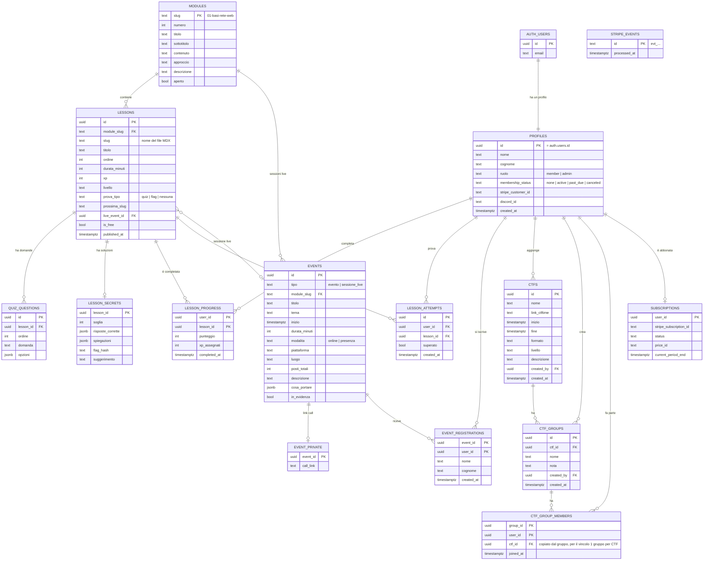

# Sec4Her — Piano del backend

_Piano di lavoro, 23 ottobre 2026. Basato su `docs/architettura.md` (Next.js + Supabase + Stripe + Vercel +
Discord) e su tutto quello che il frontend fa già oggi con dati finti (vedi `docs/STATO-PROGETTO.md`)._

> **Regola d'oro:** il browser **mostra**, il server **decide**. Tutto quello che dà un vantaggio (XP, sblocchi,
> posti, gruppi, ruoli, membership) si decide sul server; il browser non è mai la fonte della verità.

---

## 1. Lo schema del database

`docs/architettura.md` proponeva un modello minimo (`users`, `lessons`, `events`). Il frontend oggi ha bisogno di
qualche tabella in più: eccole tutte, raggruppate per sezione. Gli id sono `uuid` salvo dove indicato; i nomi
delle tabelle sono in inglese (convenzione di Supabase), i testi per l'utente restano in italiano.

| Tabella | A cosa serve | Sostituisce |
| --- | --- | --- |
| `auth.users` | Account (email, password con hash, sessioni). **Gestita da Supabase Auth**, non la tocchiamo | `config/credenzialiTest.ts` |
| `profiles` | Dati pubblici/di profilo: nome, cognome, ruolo, membership, Discord | `PROFILO_TEST` |
| `modules` | I 7 moduli del percorso | `MODULI_BASE` |
| `lessons` | Metadati delle lezioni (titolo, XP, ordine, gratuita o no). Il **testo resta in MDX** | frontmatter + lezioni finte del modulo 2 |
| `quiz_questions` | Domande e opzioni dei quiz, **senza** la risposta giusta | `prova.domande` nel frontmatter |
| `lesson_secrets` | Risposte giuste dei quiz, soglia, flag (come hash). **Mai leggibile dal browser** | `prova` nel frontmatter |
| `lesson_progress` | Chi ha completato quale lezione, quando, con che punteggio | stato in `LezioniProvider` |
| `lesson_attempts` | Tentativi di quiz/flag (per limitare i tentativi a raffica) | — (nuovo) |
| `events` | Eventi **e** sessioni live (con `module_slug` per le sessioni) | `data/eventi-mock.ts`, `SESSIONI_LIVE` |
| `event_private` | Link della call di ogni evento online | `config/links.ts` → `callEventi` |
| `event_registrations` | Iscrizioni agli eventi (nome, cognome) | stato in `useEventi` |
| `ctfs` | CTF aggiunti dalle utenti | `data/ctf-mock.ts` |
| `ctf_groups` | Gruppi di un CTF | `data/ctf-mock.ts` |
| `ctf_group_members` | Chi è in quale gruppo | `data/ctf-mock.ts` |
| `subscriptions` | Abbonamento Stripe di ogni utente (scritto **solo** dal webhook) | — (Fase 3) |
| `stripe_events` | Id degli eventi webhook già elaborati (per non elaborarli due volte) | — (Fase 3) |

Restano **nel codice** (non servono tabelle): voci del menu e contatti (`config/sito.ts`), link esterni generici
(`config/links.ts`), team e tipo di call del Meeting (`data/meeting-mock.ts`, diventa `config/team.ts`): cambiano
raramente e le prenotazioni vere stanno su **Cal.com**.

Viste (calcolate, non tabelle): `user_xp` (somma degli XP per utente, base per un futuro **rank**) e
`event_counts` (solo il **numero** di iscritte per evento, mai i nomi).

### Diagramma

### Vincoli importanti (nel database, non solo nel codice)

- `lessons`: unico (`module_slug`, `slug`) e (`module_slug`, `ordine`).
- `event_registrations`: chiave (`event_id`, `user_id`) → **un'iscrizione per persona**.
- `ctf_groups`: unico (`ctf_id`, `lower(nome)`) → niente nomi doppi nello stesso CTF; `nome` 2-30 caratteri.
- `ctf_group_members`: unico (`ctf_id`, `user_id`) → **un solo gruppo per CTF**.
- `ctfs`: `fine > inizio`, `link_ctftime` che inizia con `https://ctftime.org/`, descrizione ≤ 200 caratteri.
- I limiti "massimo 5 gruppi" e "massimo 5 membri" e "posti dell'evento" si controllano dentro **funzioni del
  database** (con blocco della riga), così due persone che cliccano insieme non superano il limite.

---

## 2. Regole Row Level Security (RLS)

**RLS attiva su tutte le tabelle**, senza eccezioni: la chiave pubblica di Supabase finisce nel browser, quindi
senza RLS chiunque potrebbe leggere o scrivere tutto. "Socia" = utente con membership attiva. "Admin" =
`profiles.ruolo = 'admin'` (controllato da una funzione `is_admin()` sul server, mai da un valore mandato dal
browser).

| Tabella | Leggere | Inserire | Modificare | Eliminare |
| --- | --- | --- | --- | --- |
| `profiles` | Solo il proprio profilo (admin: tutti) | Solo il trigger alla registrazione | Solo il proprio, **solo** `nome`, `cognome`, `discord_id`. `ruolo`, `membership_status`, `stripe_customer_id`: **solo server** | Nessuno (si elimina l'account da Auth) |
| `modules` | Tutti (anche non loggate: è la mappa pubblica) | Admin | Admin | Admin |
| `lessons` | Tutti i metadati pubblicati; il **contenuto** riservato si controlla sul server (`is_free` o socia) | Admin | Admin | Admin |
| `quiz_questions` | Utenti che possono vedere la lezione | Admin | Admin | Admin |
| `lesson_secrets` | **Nessuno dal browser.** Solo le funzioni server di verifica | Admin | Admin | Admin |
| `lesson_progress` | Solo i propri progressi | **Solo server** (dopo la verifica della prova) | Nessuno | Nessuno (admin per supporto) |
| `lesson_attempts` | Solo i propri | **Solo server** | Nessuno | Nessuno |
| `events` | Utenti loggate (eventi pubblicati) | Admin | Admin | Admin |
| `event_private` | **Solo** chi è iscritta a quell'evento (e admin) | Admin | Admin | Admin |
| `event_registrations` | Solo le proprie iscrizioni (gli altri vedono solo il **numero** tramite `event_counts`) | Tramite funzione server `iscriviti_evento` (controlla posti e date) | Solo le proprie (nome, cognome) | Solo le proprie (annulla), prima dell'inizio |
| `ctfs` | Utenti loggate | Utenti loggate (con validazione server; in futuro approvazione admin) | Chi l'ha creato, admin | Admin |
| `ctf_groups` | Utenti loggate | Tramite funzione `crea_gruppo` (limite 5, CTF non concluso, crea anche l'iscrizione) | Chi l'ha creato (nome, nota) | Automatico quando resta vuoto; admin |
| `ctf_group_members` | Utenti loggate (servono per gli avatar; mostrare solo nome/iniziali, **mai l'email**) | Tramite funzione `unisciti_gruppo` (limite 5, un gruppo per CTF, CTF non concluso) | Nessuno | Solo sé stesse (esci dal gruppo); admin |
| `subscriptions` | Solo la propria | **Solo il webhook Stripe** (chiave di servizio) | Solo webhook | Solo webhook |
| `stripe_events` | Nessuno | Solo webhook | Nessuno | Nessuno |

> "Solo server" vuol dire: Server Action o Route Handler di Next.js che usa la **chiave di servizio** di Supabase
> (che salta l'RLS), oppure una funzione Postgres `security definer` che fa i controlli. La chiave di servizio non
> deve **mai** arrivare nel browser né avere il prefisso `NEXT_PUBLIC_`.

---

## 3. Cosa deve stare sul server (e non nel browser)

| Cosa | Oggi (nel browser) | Domani (sul server) |
| --- | --- | --- |
| **Login e sessione** | `config/credenzialiTest.ts` + sessionStorage | Supabase Auth con cookie di sessione; controllo in `proxy.ts` (Next.js 16, ex middleware) **e** in ogni pagina/azione tramite un "Data Access Layer" (`lib/dal.ts`) |
| **Contenuto delle lezioni riservate** | Pagina generata in anticipo, scaricabile senza login | Pagina che controlla la sessione prima di restituire il contenuto |
| **Verifica del quiz** | Risposte nel frontmatter, confronto nel browser | Server Action `verificaQuiz(lezione, risposte)`: legge `lesson_secrets`, calcola il punteggio, restituisce le spiegazioni **solo dopo** l'invio |
| **Verifica della flag** | Flag nel frontmatter, confronto nel browser | Server Action `verificaFlag(lezione, flag)`: confronta con l'hash in `lesson_secrets`, con limite di tentativi |
| **Assegnazione XP e sblocco lezioni** | `segnaCompletata()` nel browser | Solo dopo una verifica superata, il server scrive `lesson_progress`; lo sblocco si calcola da lì |
| **"Segna come completata"** (lezioni senza prova) | Nel browser | Server Action che controlla che la lezione sia sbloccata |
| **Limiti CTF** (5 gruppi, 5 membri, 1 gruppo per CTF, CTF non concluso) | `CtfProvider.tsx` | Funzioni del database + vincoli unici |
| **Validazione dei moduli** (CTF, gruppo, iscrizione) | `lib/ctf.ts`, `lib/eventi.ts` | Le **stesse** regole rieseguite sul server (le funzioni di `lib/` sono già pure e riusabili) |
| **Posti degli eventi e sold out** | `useEventi.ts` | Funzione `iscriviti_evento` con blocco della riga |
| **Link della call** | Nascosto graficamente | Restituito dal server solo alle iscritte (`event_private` + RLS) |
| **Ruolo admin** | Non esiste | `profiles.ruolo`, modificabile solo da un'altra admin o a mano nel pannello Supabase |
| **Membership** | Non esiste | Solo dal webhook Stripe firmato (`STRIPE_WEBHOOK_SECRET`) |
| **Ruolo Discord** | Non esiste | Bot chiamato dal server dopo il webhook (token mai nel browser) |
| **Simulatore proxy** | Nel browser | Può **restare** nel browser (è una simulazione didattica); la flag che produce va verificata dal server come sopra |

---

## 4. Fasi di sviluppo del backend

Piccole e testabili, **una alla volta**, ognuna sul suo branch e con PR (regole di `CLAUDE.md`). Prima di ogni PR:
`npm run build` e `npm run lint`. Si usa un progetto Supabase **di sviluppo** separato da quello di produzione.

### Fase B0 — Prerequisiti _(prima di tutto)_

- **Obiettivo:** base sicura e pulita. Unire la PR `aggiornamento-nextjs` (Next.js 16.4.2, niente vulnerabilità
  critiche). Creare il progetto Supabase di sviluppo, installare `@supabase/supabase-js` e `@supabase/ssr`,
  aggiungere i client Supabase per server e browser.
- **File:** `package.json`, `lib/supabase/server.ts`, `lib/supabase/client.ts` (nuovi), `.env.example` (solo
  **nomi** delle variabili, nessun valore), `.env.local` (non committato).
- **Come testarla:** `npm audit` senza critiche/alte; una pagina di prova lato server legge da Supabase; `git
  status` non mostra `.env.local`.

### Fase B1 — Account veri (Supabase Auth) ⭐ _prima fase consigliata_

- **Obiettivo:** registrazione che salva davvero, login vero, logout, conferma email; protezione delle pagine
  riservate **sul server**. Eliminare le credenziali di test.
- **File:** `auth/AuthProvider.tsx`, `auth/contesto.ts`, `app/accedi/page.tsx`, `app/registrati/page.tsx`,
  `app/(riservata)/layout.tsx` (controllo sul server), `proxy.ts` (nuovo, solo redirect "ottimistico"), `lib/dal.ts`
  (nuovo, `verificaSessione()`), `lib/validazione.ts` (riusato sul server); eliminare `config/credenzialiTest.ts`.
- **Come testarla:** registrazione → email di conferma → login; password sbagliata → errore; Esci → le pagine
  riservate rimandano ad Accedi; **senza login, scaricando una pagina riservata (es. con `curl`) non si vede il
  contenuto**; `?da=//sito-esterno` porta ancora su `/home`; nessuna password nel codice (`grep`).

### Fase B2 — Profili

- **Obiettivo:** tabella `profiles` creata da un trigger alla registrazione; nome e cognome usati nei moduli al
  posto di `PROFILO_TEST`; colonna `ruolo` (default `member`).
- **File:** migrazione SQL `supabase/migrations/…_profiles.sql`, `components/eventi/ModaleIscrizione.tsx`, nuova
  pagina profilo (opzionale).
- **Come testarla:** con due account, A non legge il profilo di B; A non riesce a cambiarsi `ruolo` in `admin`
  (prova diretta con il client Supabase dalla console del browser → errore).

### Fase B3 — Lezioni: progressi, quiz e flag sul server

- **Obiettivo:** tabelle `modules`, `lessons`, `quiz_questions`, `lesson_secrets`, `lesson_progress`,
  `lesson_attempts`; Server Actions di verifica; XP e sblocchi salvati. Risposte e flag **escono** dal frontmatter
  pubblico (restano in un file solo-server o nel database).
- **File:** `lib/catalogo.ts`, `lib/lezioni.ts`, `components/lezione/Prova.tsx`, `components/lezioni/LezioniProvider.tsx`,
  `components/lezioni/StatoLezioneClient.tsx`, i file MDX in `content/lezioni/` (solo il blocco `prova`), nuovo
  `app/(riservata)/lezioni/azioni.ts`.
- **Come testarla:** la flag `sec4her{…}` **non compare** nell'HTML scaricato (`curl … | grep sec4her{`); XP e
  lezioni completate restano dopo F5 e su un altro browser; un `insert` diretto in `lesson_progress` dal browser
  viene rifiutato; dopo N flag sbagliate in un minuto il server rallenta/blocca.

### Fase B4 — Eventi e sessioni live

- **Obiettivo:** tabelle `events`, `event_private`, `event_registrations`, vista `event_counts`; funzione
  `iscriviti_evento` con controllo dei posti; link della call solo alle iscritte.
- **File:** `components/eventi/useEventi.ts`, `components/eventi/AzioniIscrizione.tsx`,
  `components/lezioni/RiquadroSessione.tsx`, `app/(riservata)/eventi/page.tsx`, `data/eventi-mock.ts` e
  `SESSIONI_LIVE` (da eliminare), `config/links.ts` (`callEventi` da eliminare).
- **Come testarla:** con due browser sull'ultimo posto libero cliccate insieme → solo una entra; il link della call
  non è nell'HTML per chi non è iscritta; iscrizione e annullamento restano dopo F5; nessun nome di altre iscritte
  visibile.

### Fase B5 — CTF Groups

- **Obiettivo:** tabelle `ctfs`, `ctf_groups`, `ctf_group_members`; funzioni `crea_gruppo`, `unisciti_gruppo`,
  `esci_gruppo` con tutti i limiti; validazione server del modulo "Aggiungi CTF".
- **File:** `components/ctf/CtfProvider.tsx`, `lib/ctf.ts` (riuso delle regole sul server), pagine `app/(riservata)/ctf/`,
  `data/ctf-mock.ts` (da eliminare).
- **Come testarla:** chiamando direttamente le funzioni dal browser: 6° gruppo rifiutato, 6° membro rifiutato,
  secondo gruppo nello stesso CTF rifiutato, azioni su CTF concluso rifiutate; link CTFtime non valido rifiutato
  anche aggirando il modulo.

### Fase B6 — Admin

- **Obiettivo:** pagine riservate alle admin per gestire eventi, sessioni live, moduli/lezioni e moderare i CTF.
- **File:** nuova cartella `app/(riservata)/admin/`, funzione SQL `is_admin()`, regole RLS per le admin.
- **Come testarla:** un'utente normale che apre `/admin` o chiama le azioni admin riceve un rifiuto **dal server**;
  un'admin crea un evento e lo vede in `/eventi`.

### Fase B7 — Membership con Stripe _(Fase 3 del piano)_

- **Obiettivo:** Stripe Checkout per l'abbonamento, webhook **firmato e verificato**, tabella `subscriptions`,
  `profiles.membership_status` aggiornato; lezioni non gratuite visibili solo alle socie; portale clienti Stripe.
- **File:** nuovi `app/api/stripe/checkout/route.ts`, `app/api/stripe/webhook/route.ts`, `lib/stripe.ts`; controllo
  della membership in `lib/dal.ts` e nelle pagine delle lezioni.
- **Come testarla:** con `stripe listen` e carte di test: pagamento → membership attiva; disdetta → disattiva; un
  webhook senza firma valida o con firma falsa viene **rifiutato** (400); lo stesso evento inviato due volte viene
  elaborato una volta sola (`stripe_events`).

### Fase B8 — Discord

- **Obiettivo:** collegare l'account Discord (OAuth) e assegnare/togliere in automatico il ruolo "socia" quando
  cambia la membership.
- **File:** nuovi `app/api/discord/callback/route.ts`, `lib/discord.ts`; chiamata dal webhook Stripe.
- **Come testarla:** abbonamento attivo → ruolo assegnato sul server Discord di prova; disdetta → ruolo tolto; il
  token del bot non compare mai nel browser.

### Fase B9 — Rifinitura sicurezza _(prima del lancio)_

- **Obiettivo:** header di sicurezza (Content-Security-Policy, ecc.), limiti di frequenza su login/flag/iscrizioni,
  log degli errori senza dati personali, backup del database, **pentest interno**.
- **File:** `next.config.ts` o `proxy.ts`, configurazione Supabase e Vercel.
- **Come testarla:** controllo degli header con gli strumenti del browser; checklist del pentest
  (`docs/TEST-CHECKLIST.md` + test di attacco su RLS, IDOR, XSS, CSRF).

---

## 5. Variabili d'ambiente

Solo i **nomi**. I valori vanno in `.env.local` (in locale, già ignorato da git) e nelle impostazioni del progetto
su **Vercel**; **mai** nel repository. Solo le variabili con prefisso `NEXT_PUBLIC_` arrivano nel browser: non
devono mai contenere segreti.

| Nome | Dove serve | Segreta? |
| --- | --- | --- |
| `NEXT_PUBLIC_SITE_URL` | Link assoluti, redirect dopo login/pagamento | No |
| `NEXT_PUBLIC_SUPABASE_URL` | Client Supabase (browser e server) | No |
| `NEXT_PUBLIC_SUPABASE_ANON_KEY` | Client Supabase (chiave pubblica, protetta dall'RLS) | No (ma RLS obbligatoria) |
| `SUPABASE_SERVICE_ROLE_KEY` | Solo server: webhook, azioni che scrivono progressi/membership | **Sì** |
| `STRIPE_SECRET_KEY` | Solo server: Checkout e portale clienti | **Sì** |
| `STRIPE_WEBHOOK_SECRET` | Solo server: verifica della firma dei webhook | **Sì** |
| `STRIPE_PRICE_ID_MEMBERSHIP` | Prezzo dell'abbonamento mensile | No (ma lasciarla lato server) |
| `DISCORD_CLIENT_ID` | OAuth per collegare l'account Discord | No |
| `DISCORD_CLIENT_SECRET` | OAuth Discord | **Sì** |
| `DISCORD_BOT_TOKEN` | Bot che assegna i ruoli | **Sì** |
| `DISCORD_GUILD_ID` | Id del server Discord | No |
| `DISCORD_MEMBER_ROLE_ID` | Id del ruolo "socia" | No |
| `FLAG_PEPPER` | Valore segreto aggiunto all'hash delle flag (così non si indovinano dal database) | **Sì** |

I link pubblici (Discord, Cal.com, Instagram) restano in `config/links.ts`: non sono segreti.
