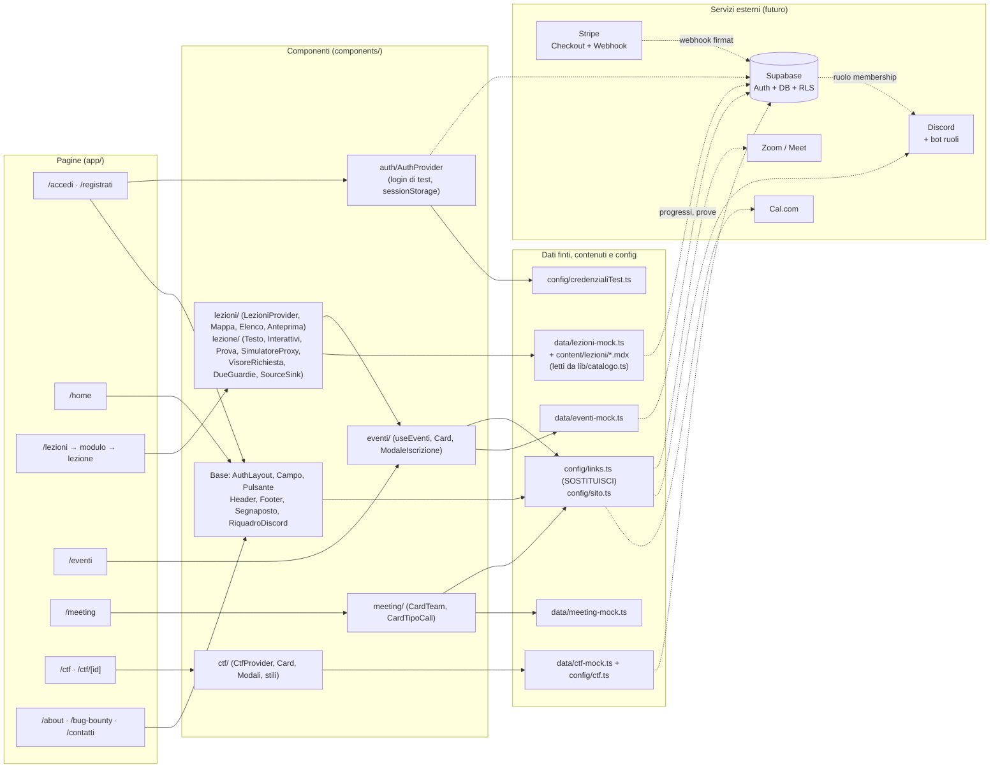

# Sec4Her — Stato del progetto

_Fotografia del progetto al **12 novembre 2026** (branch `lezioni`, ultimo commit `b866895`). Documento di sola
analisi: **non cambia il codice**. Sostituisce la versione del 23 ottobre._

> **Hacking made simple. By women, for women.**

---

## 1. Panoramica

**Sec4Her** è una community di cybersecurity fatta da donne, per donne. Il sito è **la porta e la scuola**: brand,
lezioni (note scritte in Obsidian e trasformate in MDX) e, in futuro, la membership a pagamento. La community vive
su **Discord**; le call si prenotano su **Cal.com**; i pagamenti passeranno da **Stripe**.

### A che punto siamo

Il piano di `docs/architettura.md` ha 5 fasi:

| Fase | Obiettivo | Stato |
| --- | --- | --- |
| 0 · subito | Community viva su Discord | Fuori dal sito (non verificabile da qui). Nel sito i link a Discord ci sono ma sono **segnaposto**. |
| **1** ⬅ | Fondamenta sito: landing + brand + 2-3 note pubbliche (MDX) online su Vercel | 🟡 **In corso.** Brand, menu e **8 lezioni MDX** (moduli 1 e 2) ci sono. **Mancano:** una landing pubblica (oggi `/` porta al login), note leggibili senza login e la pubblicazione su Vercel. |
| 2 | Account: Supabase Auth + note riservate | ❌ Non iniziata: c'è solo un **login di test** nel browser. |
| 3 | Monetizzazione: Stripe + webhook + ruolo Discord | ❌ Non iniziata. |
| 4 | Rifinitura: pagina eventi, polish UI, pentest | 🟡 Anticipata in parte: **Eventi**, **Meeting** e **CTF Groups** esistono già come **sola grafica**. |

**In una frase:** siamo in **Fase 1**, con molta interfaccia già pronta (anche di fasi successive) ma **nessun
backend**. Tutto quello che si fa nel sito (iscrizioni, gruppi, XP, lezioni completate) vive solo nella memoria del
browser e sparisce ricaricando la pagina.

### Cosa è cambiato dal 23 ottobre

- **Modulo 2 – Vulnerabilità web**: le 6 lezioni non sono più "in preparazione", sono **file MDX veri** con quiz
  (controllo accessi, autenticazione, XSS, injection/SSRF/secrets, parser differential + SSTI, JWT kid traversal).
- Nuovi componenti lezione: `VisoreRichiesta`, `DueGuardie`, `SourceSink`, `FraseChiave`.
- **Lezioni avanzate**: le lezioni con `livello: "Avanzato"` si sbloccano solo dopo tutte le lezioni base del modulo.
- **Modalità anteprima** (solo sviluppo, `config/anteprima.ts`) per vedere qualsiasi lezione ignorando i lucchetti.

### I numeri

| Cosa | Quanti |
| --- | --- |
| File `page.tsx` | **12**, che generano **27 indirizzi** fissi + `/ctf/[id]` (uno per CTF, oggi 4 finti) |
| Pagine "vere" (con contenuto) | 9 tipi: Accedi, Registrati, Home, Lezioni (percorso, modulo, lezione), Eventi, Meeting, CTF (lista, dettaglio) |
| Pagine segnaposto ("in costruzione") | 3: About us, Bug Bounty Group, Contact us |
| Componenti React | **54 file** in `components/` (51 `.tsx`) |
| Lezioni MDX | **8** (2 nel modulo 1, 6 nel modulo 2); moduli 3-7 chiusi ("prossimamente") |
| Componenti utilizzabili nelle lezioni MDX | 30 |
| File di dati finti | 4 in `data/` (+ `config/credenzialiTest.ts`) |
| Funzionalità censite (sezione 4) | **66**: ✅ 40 · 🟡 7 · ❌ 19 |

---

## 2. Mappa del sito

**Pubblica** = si vede senza login. **Riservata** = solo dopo il login (oggi il controllo è solo nel browser, vedi
sezione 7).

| Indirizzo | A cosa serve | Accesso |
| --- | --- | --- |
| `/` | Nessun contenuto: rimanda subito ad `/accedi` | Pubblica |
| `/accedi` | Login con email e password (oggi solo le credenziali di test). Con `?da=/pagina` dopo il login torna lì | Pubblica |
| `/registrati` | Modulo di registrazione (nome, email, password, conferma). **Non salva nulla** | Pubblica |
| indirizzo inesistente | Rimanda ad `/accedi` (`app/not-found.tsx`) | Pubblica |
| `/home` | Logo completo "HACK THE FUTURE" e testo di presentazione (segnaposto) | Riservata |
| `/lezioni` | Il percorso in 7 moduli: mappa, stato dei moduli, barra di avanzamento, XP, prossima sessione live | Riservata |
| `/lezioni/[modulo]` | Pagina di un modulo (7 indirizzi): descrizione, elenco lezioni con lucchetti, sessione live | Riservata |
| `/lezioni/[modulo]/[lezione]` | Pagina di una lezione (8 indirizzi): testo MDX, componenti interattivi, prova (quiz/flag), sessione live | Riservata |
| ↳ `/lezioni/01-basi-rete-web/01-networking-le-basi` | Networking: le basi — quiz | Riservata |
| ↳ `/lezioni/01-basi-rete-web/02-intercettiamo-un-login` | Simulatore proxy — flag | Riservata |
| ↳ `/lezioni/02-vulnerabilita-web/01…06` | 6 lezioni di vulnerabilità web — quiz (5 e 6 "Avanzato") | Riservata |
| `/eventi` | Evento del mese, prossimi eventi con filtri, eventi passati, iscrizione | Riservata |
| `/meeting` | Founder e Co-founder, prenotazione Call 1:1 su Cal.com, rimando alle sessioni live | Riservata |
| `/ctf` | Lista dei CTF con filtri (in arrivo, in corso, conclusi) e "Aggiungi CTF" | Riservata |
| `/ctf/[id]` | Dettaglio di un CTF: gruppi, "Unisciti", "Crea gruppo" (unica pagina generata a richiesta) | Riservata |
| `/about`, `/bug-bounty`, `/contatti` | Segnaposto "[in costruzione]" | Riservata |

Totale: 3 pubblici (`/`, `/accedi`, `/registrati`) + 24 riservati (home; lezioni 1 + 7 moduli + 8 lezioni; eventi;
meeting; ctf; 3 segnaposto) + le pagine `/ctf/[id]`.

---

## 3. Schema dell'architettura

Le frecce piene esistono oggi; quelle tratteggiate sono il **futuro** (Fasi 2-3).



---

## 4. Funzionalità per sezione

Legenda: ✅ fatto (grafica, dati finti) · 🟡 parziale · ❌ non fatto.
Nessuna funzionalità ha ancora un backend: "✅" vuol dire che **nel browser funziona**, non che salva dati.

### Login e registrazione

| Funzionalità | Stato | Note |
| --- | --- | --- |
| Pagina Accedi con controlli dei campi in italiano | ✅ | `lib/validazione.ts` |
| Login con credenziali di test | ✅ | Solo nel browser, `config/credenzialiTest.ts` |
| Ritorno alla pagina richiesta dopo il login (`?da=`) con protezione da open redirect | ✅ | `percorsoInterno` |
| Pagina Registrati con controlli dei campi | ✅ | |
| Registrazione che salva davvero l'account | ❌ | Fase 2 (Supabase Auth) |
| Login vero / password dimenticata | ❌ | Fase 2 |
| Conferma email | ❌ | Fase 2 |
| Pagine riservate protette | 🟡 | Solo lato browser: il contenuto è comunque nell'HTML scaricabile (sezione 7) |
| Logout ("Esci") | ✅ | Dal menu |

### Home

| Funzionalità | Stato | Note |
| --- | --- | --- |
| Logo completo e testo di presentazione | ✅ | Testo segnaposto (`DESCRIZIONE`) |
| Landing pubblica (brand, storia, note gratuite) | ❌ | Prevista in Fase 1: oggi `/` porta al login |

### Menu (header)

| Funzionalità | Stato | Note |
| --- | --- | --- |
| Header fisso con logo che porta a `/home` | ✅ | |
| Menu ☰ con 7 voci + Esci, si chiude con click fuori ed Esc | ✅ | `config/sito.ts` |
| About us, Bug Bounty Group, Contact us | 🟡 | Solo segnaposto "[in costruzione]" |

### Lezioni

| Funzionalità | Stato | Note |
| --- | --- | --- |
| Percorso in 7 moduli con mappa e stati | ✅ | Moduli 3-7 "🔒 prossimamente" |
| Pagina modulo con elenco lezioni e lucchetti | ✅ | |
| Lezioni scritte in MDX con frontmatter (titolo, durata, XP, prova…) | ✅ | `lib/catalogo.ts` |
| Modulo 1 (2 lezioni) | ✅ | Quiz + simulatore proxy con flag |
| Modulo 2 (6 lezioni di vulnerabilità web) | ✅ | Tutte con quiz; riquadro "Allenati sul lab" (PortSwigger) |
| Componenti di testo (Intro, Passo, LatoHacker, FraseChiave, Bottino…) | ✅ | `components/lezione/Testo.tsx` |
| Componenti interattivi (porte, DNS, lettera HTTP, status code, HTTPS, viaggio) | ✅ | `Interattivi.tsx` |
| Componenti vulnerabilità web (VisoreRichiesta, DueGuardie, SourceSink) | ✅ | Nuovi |
| Mappa dei concetti che si illumina scorrendo | ✅ | |
| Quiz finale con soglia e spiegazioni | ✅ | Verificato nel browser |
| Flag finale | ✅ | Verificata nel browser |
| Simulatore proxy (Intercept, Forward/Drop, modifica, checklist) | ✅ | Lezione 2 del modulo 1 |
| Sblocco della lezione successiva / lezioni avanzate dopo le basi | ✅ | Si perde ricaricando |
| Modalità anteprima (solo sviluppo) | ✅ | Spenta in produzione |
| Sessione live della lezione con iscrizione e `.ics` | ✅ | Riusa gli eventi |
| "Fai una domanda su Discord" | 🟡 | Link segnaposto |
| Moduli 3-7 | ❌ | Nessun contenuto |
| Note gratuite (pubbliche) vs riservate (`is_free`) | ❌ | Fase 1/2 |

### Gamification

| Funzionalità | Stato | Note |
| --- | --- | --- |
| XP per lezione completata e totale XP (⚡) | ✅ | Si azzera ricaricando |
| Barra di avanzamento "N/8 lezioni completate" | ✅ | |
| Badge "Avanzato" e livelli delle lezioni | ✅ | Da frontmatter |
| Rank / livelli dell'utente | ❌ | Non esiste nel codice |
| Badge / traguardi | ❌ | |
| Classifica | ❌ | |
| Progressi salvati tra una visita e l'altra | ❌ | Serve il database |

### Profilo

| Funzionalità | Stato | Note |
| --- | --- | --- |
| Pagina profilo (nome, avatar, XP, iscrizioni) | ❌ | Esiste solo `PROFILO_TEST` (nome finto) per precompilare i moduli |
| Stato della membership / gestione abbonamento | ❌ | Fase 3 (Stripe) |
| Collegamento account Discord | ❌ | Fase 3 |

### Admin

| Funzionalità | Stato | Note |
| --- | --- | --- |
| Area admin (eventi, CTF, sessioni live, utenti) | ❌ | Non esiste. Oggi chiunque può "aggiungere CTF" |
| Ruolo admin | ❌ | Va gestito sul server |

### Eventi

| Funzionalità | Stato | Note |
| --- | --- | --- |
| Evento del mese con conto alla rovescia | ✅ | |
| Prossimi eventi con filtri per tema e modalità | ✅ | |
| Eventi passati in grigio | ✅ | |
| Iscrizione con nome e cognome, annullamento | ✅ | Non salvata |
| Posti, "Sold out" | ✅ | Controllo solo nel browser |
| Link della call visibile solo dopo l'iscrizione | 🟡 | Nascosto solo graficamente: è nel codice |
| File `.ics` per il calendario | ✅ | `lib/ics.ts` |
| Email di conferma / promemoria | ❌ | |

### Meeting

| Funzionalità | Stato | Note |
| --- | --- | --- |
| Card Founder e Co-founder | 🟡 | Nomi segnaposto ("Nome Founder"), niente foto |
| Prenotazione Call 1:1 su Cal.com | 🟡 | Link segnaposto `SOSTITUISCI` |
| Rimando alle sessioni live delle Lezioni | ✅ | |

### CTF Groups

| Funzionalità | Stato | Note |
| --- | --- | --- |
| Lista CTF con stato calcolato dalle date e filtri | ✅ | |
| Aggiungi CTF con controlli (link CTFtime, date…) | ✅ | Non salvato |
| Dettaglio CTF con gruppi e avatar | ✅ | |
| Crea gruppo / Unisciti / Esci dal gruppo | ✅ | Non salvato |
| Limiti: 5 gruppi per CTF, 5 membri, 1 gruppo per utente | ✅ | Controllati solo nel browser |
| CTF conclusi in sola lettura | ✅ | |
| Moderazione (chi aggiunge/elimina un CTF) | ❌ | |
| Canale Discord del gruppo | ❌ | |

### Footer

| Funzionalità | Stato | Note |
| --- | --- | --- |
| Contatti (Email, Instagram, Discord), slogan, © | ✅ | |
| Contatti reali | 🟡 | Valori segnaposto |
| Footer anche su Accedi / Registrati | ❌ | Lì c'è solo la card (scelta voluta, da confermare) |

**Totale:** 66 funzionalità — ✅ 40 · 🟡 7 · ❌ 19.

---

## 5. Dati finti da sostituire

| File | Cosa contiene | Sostituito da (tabella del database) |
| --- | --- | --- |
| `config/credenzialiTest.ts` | Email/password di test e `PROFILO_TEST` (nome, cognome) | **Supabase Auth** (`auth.users`) + `profiles` — il file va **eliminato** |
| `data/lezioni-mock.ts` → `MODULI_BASE` | 7 moduli (titolo, descrizione, aperto/chiuso) + 6 lezioni "di riserva" del modulo 2 (copia del frontmatter) | `modules` (+ `lessons` per i metadati). Il testo resta in MDX |
| `data/lezioni-mock.ts` → `COMPLETATE_INIZIALI` | Lezioni già completate all'avvio (vuoto) | `lesson_progress` |
| `data/lezioni-mock.ts` → `SESSIONI_LIVE` | 3 sessioni live (Caido, OWASP, XSS) con piattaforma, link e numero di iscritte | `events` (tipo `sessione_live`, con `module_id`) + `event_registrations` |
| Frontmatter MDX → `prova` | Risposte giuste dei quiz e flag (8 lezioni) | `lesson_challenges` (leggibile **solo dal server**) |
| `data/eventi-mock.ts` | 6 eventi (4 in programma, 2 passati), posti, numero di iscritte | `events` + `event_registrations` |
| `data/meeting-mock.ts` | Team (nomi segnaposto, argomenti) e tipo di call (Call 1:1) | Può restare nel codice con i valori veri; in alternativa `team_members` |
| `data/ctf-mock.ts` | 4 CTF e i loro gruppi con membri finti (`@esempio.it`) | `ctfs`, `ctf_groups`, `ctf_group_members` |
| `config/links.ts` | Link esterni segnaposto (`SOSTITUISCI`); link PortSwigger reali | Restano in config (valori veri); il **link della call** di ogni evento va in `events.call_link` |
| `config/sito.ts` → `CONTATTI` | Email e Instagram segnaposto | Restano in config con i valori veri |

Lo schema completo delle tabelle e le regole RLS sono in `docs/PIANO-BACKEND.md`.

---

## 6. Problemi trovati

Solo elenco, **niente è stato corretto**. Gravità: 🔴 alta · 🟠 media · 🟢 bassa.

### Risultato dei controlli automatici (12/11/2026, branch `lezioni`)

| Controllo | Risultato |
| --- | --- |
| `npx tsc --noEmit` | ✅ Nessun errore TypeScript |
| `npm run build` | ✅ Build riuscita (Next.js 16.4.2 installato in locale), 28 pagine generate, nessun avviso |
| `npm run lint` (oxlint) | ✅ Nessun avviso |
| `npm audit` | 🔴 **1 vulnerabilità critica** in `next`: il `package-lock.json` di `lezioni` indica ancora Next.js **16.4.0** |

### Elenco

| # | Gravità | Problema | Dove |
| --- | --- | --- | --- |
| 1 | 🔴 | **Risposte dei quiz e flag di TUTTE le lezioni sono in OGNI pagina delle Lezioni.** Il layout passa l'intero catalogo (con `prova`) al `LezioniProvider`, che è un componente del browser: la flag della lezione "Intercettiamo un login" si trova nell'HTML di 66 file generati dalla build (anche `/lezioni`). Basta "Visualizza sorgente" | `app/(riservata)/lezioni/layout.tsx`, `components/lezioni/LezioniProvider.tsx` |
| 2 | 🔴 | **Next.js vulnerabile nel branch `lezioni`**: `package.json` dice `^16.4.0` e il lock 16.4.0 (critica). La correzione è nel branch `aggiornamento-nextjs`, non ancora unito. In locale funziona perché `node_modules` ha già 16.4.2, ma chi fa `npm install` da zero riceve la versione vulnerabile | `package.json`, `package-lock.json` |
| 3 | 🔴 | **Le pagine "riservate" si scaricano senza login**: il controllo è nel layout lato browser, ma le pagine sono generate in anticipo (HTML statico). Testo delle lezioni, quiz e flag si leggono senza account | `app/(riservata)/layout.tsx` |
| 4 | 🟠 | **`main` è fermo al primo commit**: nessuna PR è mai stata unita, e i branch sono a catena (`login` → `home` → … → `lezioni`). Più si aspetta, più la prima PR sarà enorme e difficile da revisionare | GitHub |
| 5 | 🟠 | **Manca una landing pubblica**: la Fase 1 prevede landing + 2-3 note pubbliche, ma `/` e ogni indirizzo sconosciuto portano al login | `app/page.tsx`, `app/not-found.tsx` |
| 6 | 🟠 | **Nessun test automatico** nel repository e nessuno script `npm test` | `package.json` |
| 7 | 🟠 | **Lezione 5 del modulo 2 basata su "un caso reale (anonimizzato)"** con dettagli della catena (tentativi, errori di apici, fix). Le regole dicono "mai dettagli di bug reali": va fatta una verifica da founder/co-founder | `content/lezioni/02-vulnerabilita-web/05-parser-differential-ssti.mdx` |
| 8 | 🟠 | **Dati delle lezioni del modulo 2 duplicati**: titolo, durata, XP e livello sono sia nel frontmatter MDX sia in `MODULI_BASE` ("lezioni di riserva", mai usate perché i file esistono). Cambiandone uno, l'altro resta vecchio | `data/lezioni-mock.ts` |
| 9 | 🟠 | **Codice condiviso nella cartella sbagliata**: `components/ctf/stili.ts` e `components/ctf/useOra.ts` sono usati da Eventi, Meeting, Lezioni e `mdx-components.tsx` (20 file fuori da `ctf/`) | `components/ctf/` |
| 10 | 🟠 | **Comportamento incoerente al ricaricamento**: il login resta (sessionStorage), ma XP, lezioni completate, iscrizioni e gruppi spariscono | Provider di Lezioni, Eventi, CTF |
| 11 | 🟢 | **Componenti delle lezioni in due cartelle**: `components/lezione/` e `components/lezioni/mdx/` (Callout, Schema, RichiestaHttp). Confonde chi scrive una lezione | `components/` |
| 12 | 🟢 | **Codice non usato**: `RichiestaHttp` / blocco ```` ```http ```` (nessuna lezione lo usa), `linkSegnaposto()` e `LINKS.portswigger` (le URL sono scritte a mano nei file MDX) | `components/lezioni/mdx/RichiestaHttp.tsx`, `config/links.ts` |
| 13 | 🟢 | **Pagine generate due volte**: la pagina segnaposto `[sezione]` genera anche `/lezioni`, `/eventi`, `/meeting`, `/ctf`, che hanno già una pagina vera (vince quella vera, ma è lavoro inutile e confonde) | `app/(riservata)/[sezione]/page.tsx` |
| 14 | 🟢 | **Versioni non allineate in `package.json`**: `next` `^16.4.0` ma `@next/mdx` `^16.4.2` | `package.json` |
| 15 | 🟢 | **Stile diverso tra pagine**: Home e segnaposto hanno la parte centrale **bianca**, Lezioni/Eventi/Meeting/CTF sono **scure** | `app/(riservata)/layout.tsx` |
| 16 | 🟢 | **Data model dei documenti superato**: `docs/architettura.md` prevede 3 tabelle; il frontend ne richiede circa 15 (vedi `PIANO-BACKEND.md`) | `docs/architettura.md` |
| 17 | 🟢 | **PDF di appunti nella radice del repository** (`Appunti Linux/`, `Appunti Introduzione al networking/`, `Introduzione_CTF/`, `Presentazione Lucrezia/`): fuori dalla struttura `docs/` e con nomi con spazi | radice |
| 18 | 🟢 | **Testi e link segnaposto** ancora da sostituire: `SOSTITUISCI` nei link, contatti, nomi del team, testo della Home | `config/`, `data/meeting-mock.ts`, `home/page.tsx` |
| 19 | 🟢 | **Chiunque può aggiungere un CTF** e non si può eliminarlo: manca la moderazione | `components/ctf/` |

---

## 7. Rischi di sicurezza attuali

Oggi il sito è **in sviluppo e non pubblico**: questi rischi sono accettabili **solo finché resta così**. Nessuno
va portato in produzione.

| Rischio | Perché è un problema | Quando si risolve |
| --- | --- | --- |
| **Credenziali di test nel codice** (`test@sec4her.com` / `Test1234!`) | Chiunque apra il sito le legge nel JavaScript scaricato | **Fase 2**: Supabase Auth, poi eliminare `config/credenzialiTest.ts` |
| **Login e protezione solo nel browser** | Basta scaricare la pagina (o modificare il browser) per vedere i contenuti riservati | **Fase 2**: sessione Supabase controllata dal server (proxy/middleware + Server Components) |
| **Risposte dei quiz e flag nel browser, per tutte le lezioni insieme** | Sono nel frontmatter MDX e finiscono nell'HTML di ogni pagina delle Lezioni | **Fase 2**: tolte dal catalogo pubblico, verificate da un'azione server. Prima del deploy pubblico (Fase 1) almeno non passarle al browser |
| **XP e lezioni completate decisi dal browser** | Chiunque potrebbe darsi XP e sbloccare lezioni | **Fase 2**: il server assegna gli XP dopo aver verificato la prova |
| **Lucchetti delle lezioni solo grafici** | Il testo delle lezioni bloccate è comunque nella pagina | **Fase 2**: il server manda il contenuto solo se la lezione è sbloccata |
| **Modalità anteprima** (`config/anteprima.ts`) | Oggi **spenta** (`ANTEPRIMA_LEZIONI = false`) e sempre disattivata in produzione (`NODE_ENV`). Rischio basso: ignora solo i lucchetti grafici, che sono già aggirabili | Quando i lucchetti diventano server: o si rimuove o si limita al ruolo admin |
| **Limiti CTF e posti degli eventi controllati nel browser** | Si aggirano facilmente; con più persone insieme si superano i limiti | **Fase 2**: vincoli nel database + RLS |
| **Link delle call "nascosti" solo graficamente** | Sono nel codice: chi non è iscritta li trova | **Fase 2**: il server li restituisce solo alle iscritte (RLS) |
| **Nessun ruolo admin**: chiunque aggiunge CTF | Spam o link malevoli nella lista | **Fase 2**: ruolo admin sul server, moderazione |
| **Next.js 16.4.0 vulnerabile** nel lock di `lezioni` | Vulnerabilità critica nota | **Subito**: unire `aggiornamento-nextjs` |
| **Nessun header di sicurezza** (Content-Security-Policy, ecc.) | Difesa in più contro XSS e clickjacking | **Prima del lancio** (Fase 4), insieme al pentest |
| **Membership non ancora gestita** | Senza webhook firmati lo stato si potrebbe falsificare | **Fase 3**: Stripe Checkout + webhook firmato e verificato |

**Cosa è già fatto bene:** nessun segreto nel repository (`.env.local` ignorato), protezione da open redirect su
`?da=`, link esterni con `rel="noopener noreferrer"`, link nelle lezioni MDX filtrati (solo `https`, `http`,
`mailto` e interni, mai `javascript:`), nessun `dangerouslySetInnerHTML` (anche il simulatore mostra le risposte
come testo), frontmatter letto "senza fidarsi" (valori sbagliati non rompono la pagina), controlli di tutti i
moduli con messaggi chiari.

---

## 8. Pronti per il backend?

**Risposta breve: quasi.** La parte grafica è abbastanza matura e il piano (`docs/PIANO-BACKEND.md`) è già scritto.
Prima di toccare Supabase conviene chiudere alcune cose, altrimenti il backend nasce su fondamenta instabili.

### Cosa manca prima di iniziare (Fase B0)

1. **Aggiornare Next.js** unendo `aggiornamento-nextjs` in `lezioni` (problema 2).
2. **Portare il lavoro su `main`**: aprire la PR (anche a pezzi) e farla revisionare. Il backend va costruito su
   un `main` aggiornato, non in fondo a una catena di branch (problema 4).
3. **Decidere cosa è pubblico**: quali 2-3 note sono gratuite e cosa mostra la landing. Serve per scrivere le regole
   RLS (campo `is_free`) e per la protezione delle pagine.
4. **Creare il progetto Supabase** (regione UE), salvare le chiavi solo in `.env.local` e su Vercel, mai su GitHub.
   La `service_role` key non va mai nel codice del browser.
5. **Aggiornare `docs/architettura.md`** con il data model vero (problema 16).
6. *(consigliato)* Aggiungere un minimo di test automatici per `lib/validazione.ts` e `lib/lezioni.ts`.

### Prima fase di backend consigliata: **B1 — Account veri con Supabase Auth**

È la base di tutto (senza utenti non esistono progressi, iscrizioni, gruppi né membership) e risolve subito i due
rischi più grossi: credenziali di test e protezione solo nel browser.

Passi concreti:

1. Installare `@supabase/supabase-js` e `@supabase/ssr`; creare i client "server" e "browser" in `lib/supabase/`.
2. Variabili in `.env.local`: `NEXT_PUBLIC_SUPABASE_URL`, `NEXT_PUBLIC_SUPABASE_ANON_KEY` (mai la service role).
3. Tabella `profiles` (id = `auth.users.id`, nome, cognome, ruolo) con **RLS attiva**: ognuna legge e modifica solo
   il proprio profilo; trigger che crea il profilo alla registrazione.
4. **Registrati** e **Accedi** chiamano Supabase con una **Server Action** che ripete sul server i controlli di
   `lib/validazione.ts`. Aggiungere conferma email e "password dimenticata".
5. **Protezione sul server**: il proxy/middleware di Next.js (leggere `AGENTS.md` e la guida di Next 16) controlla
   la sessione e reindirizza ad `/accedi?da=…`; le pagine riservate non devono più essere HTML statico pubblico.
6. Sostituire `AuthProvider` (sessionStorage) con la sessione Supabase; "Esci" chiama `signOut`.
7. **Eliminare `config/credenzialiTest.ts`** e `PROFILO_TEST` (i moduli si precompilano da `profiles`).
8. Testare: registrazione, conferma, login, logout, pagina riservata senza login, `?da=//sito-esterno`, un utente
   che prova a leggere il profilo di un'altra (deve fallire per RLS).

Subito dopo: **B3 — Lezioni sul server** (quiz e flag verificati da una Server Action, risposte fuori dal browser,
progressi in `lesson_progress`), che chiude il problema 1.
