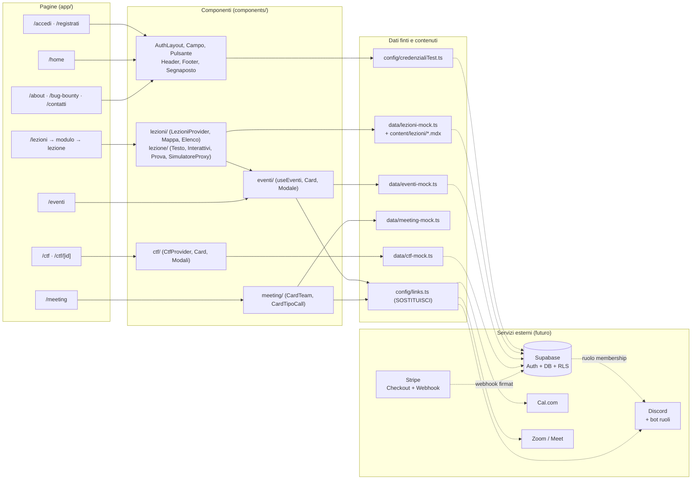

# Sec4Her — Stato del progetto

_Fotografia del progetto al 23 ottobre 2026 (branch `lezioni`). Documento di sola analisi: non cambia il codice._

> **Hacking made simple. By women, for women.**

---

## 1. Panoramica

**Sec4Her** è una community di cybersecurity fatta da donne, per donne. Il sito è **la porta e la scuola**: brand,
lezioni (note scritte in Obsidian e trasformate in MDX) e, in futuro, la membership a pagamento. La community vive
su **Discord**; le call si prenotano su **Cal.com**; i pagamenti passeranno da **Stripe**.

### A che punto siamo

Il piano di `docs/architettura.md` ha 5 fasi:

| Fase | Obiettivo | Stato |
| --- | --- | --- |
| 0 · subito | Community viva su Discord | Fuori dal sito (non verificabile da qui). Nel sito i link a Discord ci sono ma sono **segnaposto**. |
| **1** | Fondamenta sito: landing + brand + 2-3 note pubbliche (MDX) online su Vercel | 🟡 **In corso.** Brand, menu e prime 2 lezioni MDX ci sono. **Mancano:** una landing pubblica (oggi `/` porta al login), note pubbliche senza login e la pubblicazione su Vercel. |
| 2 | Account: Supabase Auth + note riservate | ❌ Non iniziata: c'è solo un **login di test** nel browser. |
| 3 | Monetizzazione: Stripe + webhook + ruolo Discord | ❌ Non iniziata. |
| 4 | Rifinitura: pagina eventi, polish UI, pentest | 🟡 Anticipata in parte: le pagine **Eventi**, **Meeting** e **CTF Groups** esistono già come **sola grafica**. |

**In una frase:** siamo in **Fase 1**, con molta interfaccia già pronta (anche di fasi successive) ma **nessun
backend**. Tutto quello che si fa nel sito (iscrizioni, gruppi, XP) vive solo nella memoria del browser e sparisce
ricaricando la pagina.

### I numeri

| Cosa | Quanti |
| --- | --- |
| Pagine (file `page.tsx`) | 12 file, che generano **27 indirizzi** (vedi mappa) |
| Pagine "vere" (con contenuto) | 9 tipi di pagina: Accedi, Registrati, Home, Lezioni (3 livelli), Eventi, Meeting, CTF (2 livelli) |
| Pagine segnaposto ("in costruzione") | 3: About us, Bug Bounty Group, Contact us |
| Componenti React | 49 file in `components/` |
| Lezioni MDX vere | 2 (modulo 1), più 5 lezioni "in preparazione" del modulo 2 |
| File di dati finti | 4 in `data/` |
| Funzionalità censite (sezione 4) | 61: ✅ 35 · 🟡 8 · ❌ 18 |

---

## 2. Mappa del sito

**Pubblica** = si vede senza login. **Riservata** = solo dopo il login (oggi il controllo è solo nel browser, vedi
sezione 8).

| Indirizzo | A cosa serve | Accesso |
| --- | --- | --- |
| `/` | Non ha contenuto: rimanda subito ad `/accedi` | Pubblica |
| `/accedi` | Login con email e password (oggi solo le credenziali di test). Con `?da=/pagina` dopo il login torna lì | Pubblica |
| `/registrati` | Modulo di registrazione (nome, email, password, conferma). **Non salva nulla** | Pubblica |
| qualsiasi indirizzo inesistente | Rimanda ad `/accedi` (`app/not-found.tsx`) | Pubblica |
| `/home` | Logo completo "HACK THE FUTURE" e testo di presentazione (segnaposto) | Riservata |
| `/lezioni` | Il percorso in 7 moduli: mappa, stato di ogni modulo, barra di avanzamento, XP | Riservata |
| `/lezioni/[modulo]` | Pagina di un modulo (7 indirizzi, da `01-basi-rete-web` a `07-eventi-a-tema`): descrizione, elenco lezioni con lucchetti, sessione live | Riservata |
| `/lezioni/[modulo]/[lezione]` | Pagina di una lezione (7 indirizzi): testo MDX, componenti interattivi, prova finale (quiz/flag), sessione live | Riservata |
| ↳ `/lezioni/01-basi-rete-web/01-networking-le-basi` | Lezione 1: networking, con quiz finale | Riservata |
| ↳ `/lezioni/01-basi-rete-web/02-intercettiamo-un-login` | Lezione 2: simulatore proxy, con flag finale | Riservata |
| ↳ `/lezioni/02-vulnerabilita-web/…` (5) | Lezioni del modulo 2: "note in preparazione" | Riservata |
| `/eventi` | Evento del mese, prossimi eventi con filtri (tema, modalità), eventi passati, iscrizione | Riservata |
| `/meeting` | Founder e Co-founder, prenotazione Call 1:1 su Cal.com, rimando alle sessioni live | Riservata |
| `/ctf` | Lista dei CTF con filtri (in arrivo, in corso, conclusi) e "Aggiungi CTF" | Riservata |
| `/ctf/[id]` | Dettaglio di un CTF: gruppi, "Unisciti", "Crea gruppo" | Riservata |
| `/about` | Segnaposto "[in costruzione]" | Riservata |
| `/bug-bounty` | Segnaposto "[in costruzione]" | Riservata |
| `/contatti` | Segnaposto "[in costruzione]" | Riservata |

Totale indirizzi: 2 pubblici (`/accedi`, `/registrati`) + 2 di redirect (`/`, inesistenti) + 23 riservati (home,
lezioni 1 + 7 moduli + 7 lezioni, eventi, meeting, ctf, ctf/[id], 3 segnaposto). Le pagine `/ctf/[id]` cambiano in base ai CTF (oggi 4 finti).

---

## 3. Schema dell'architettura

Oggi le frecce piene sono reali; quelle tratteggiate sono il **futuro** (Fasi 2-3).

---

## 4. Funzionalità per sezione

Legenda: ✅ fatto (solo grafica, dati finti) · 🟡 parziale · ❌ non fatto.
Nessuna funzionalità ha ancora un backend: "✅" vuol dire che **nel browser funziona**, non che salva dati.

### Login e registrazione

| Funzionalità | Stato | Note |
| --- | --- | --- |
| Pagina Accedi con controlli dei campi in italiano | ✅ | `lib/validazione.ts` |
| Login con credenziali di test | ✅ | Solo nel browser, `config/credenzialiTest.ts` |
| Ritorno alla pagina richiesta dopo il login (`?da=`) con protezione da open redirect | ✅ | `percorsoInterno` |
| Pagina Registrati con controlli dei campi | ✅ | |
| Registrazione che salva davvero l'account | ❌ | Fase 2 (Supabase Auth) |
| Login vero / OAuth / password dimenticata | ❌ | Fase 2 |
| Conferma email | ❌ | Fase 2 |
| Pagine riservate protette | 🟡 | Solo lato browser; il contenuto si scarica comunque (sezione 8) |
| Logout ("Esci") | ✅ | Dal menu |

### Home

| Funzionalità | Stato | Note |
| --- | --- | --- |
| Logo completo e testo di presentazione | ✅ | Testo segnaposto (`DESCRIZIONE`) |
| Landing pubblica (brand, storia, note gratuite) | ❌ | Prevista in Fase 1: oggi `/` porta al login |

### Menu (header)

| Funzionalità | Stato | Note |
| --- | --- | --- |
| Header fisso con logo che porta a `/home` | ✅ | |
| Menu ☰ con 7 voci + Esci, si chiude con click fuori ed Esc | ✅ | `config/sito.ts` |
| About us, Bug Bounty Group, Contact us | 🟡 | Esistono solo come segnaposto "[in costruzione]" |

### Lezioni

| Funzionalità | Stato | Note |
| --- | --- | --- |
| Percorso in 7 moduli con mappa e stati | ✅ | Moduli 3-7 "🔒 prossimamente" |
| Pagina modulo con elenco lezioni e lucchetti | ✅ | |
| Lezioni scritte in MDX con frontmatter (titolo, durata, XP, prova…) | ✅ | `lib/catalogo.ts` |
| Componenti di testo (Intro, Passo, LatoHacker, Bottino…) | ✅ | `components/lezione/Testo.tsx` |
| Componenti interattivi (porte, DNS, lettera HTTP, status code, HTTPS, viaggio) | ✅ | `Interattivi.tsx` |
| Mappa dei concetti che si illumina scorrendo | ✅ | |
| Quiz finale con soglia (es. 4/5) e spiegazioni | ✅ | Verificato nel browser |
| Flag finale | ✅ | Verificata nel browser |
| Simulatore proxy (Intercept, Forward/Drop, modifica, checklist) | ✅ | Lezione 2 |
| Sblocco della lezione successiva | ✅ | Si perde ricaricando |
| Sessione live della lezione con iscrizione e `.ics` | ✅ | Riusa gli eventi |
| "Fai una domanda su Discord" | 🟡 | Link segnaposto |
| Lezioni del modulo 2 | 🟡 | Titoli presenti, testo "in preparazione" |
| Note gratuite vs riservate (`is_free`) | ❌ | Fase 2 |

### Gamification

| Funzionalità | Stato | Note |
| --- | --- | --- |
| XP per lezione completata e totale XP (⚡) | ✅ | Si azzera ricaricando |
| Barra di avanzamento "N/7 lezioni completate" | ✅ | |
| Rank / livelli (es. "Script kiddie → Hacker") | ❌ | Non esiste nel codice |
| Badge / traguardi | ❌ | |
| Classifica | ❌ | |
| Progressi salvati tra una visita e l'altra | ❌ | Serve il database |

### Profilo

| Funzionalità | Stato | Note |
| --- | --- | --- |
| Pagina profilo (nome, avatar, XP, iscrizioni) | ❌ | Esiste solo `PROFILO_TEST` (nome e cognome finti) per precompilare i moduli |
| Stato della membership / gestione abbonamento | ❌ | Fase 3 (Stripe billing portal) |
| Collegamento account Discord | ❌ | Fase 3 |

### Admin

| Funzionalità | Stato | Note |
| --- | --- | --- |
| Area admin (gestire eventi, CTF, sessioni live, utenti) | ❌ | Non esiste. Oggi chiunque può "aggiungere CTF" |
| Ruolo admin | ❌ | Va gestito sul server |

### Eventi

| Funzionalità | Stato | Note |
| --- | --- | --- |
| Evento del mese con conto alla rovescia | ✅ | |
| Prossimi eventi con filtri per tema e modalità | ✅ | |
| Eventi passati in grigio | ✅ | |
| Iscrizione con nome e cognome, annullamento | ✅ | Non salvata |
| Posti, "Sold out" | ✅ | Controllo solo nel browser |
| Link della call visibile solo dopo l'iscrizione | 🟡 | Nascosto solo graficamente: è nel codice |
| File `.ics` per il calendario | ✅ | `lib/ics.ts` |
| Email di conferma / promemoria | ❌ | |

### Meeting

| Funzionalità | Stato | Note |
| --- | --- | --- |
| Card Founder e Co-founder | 🟡 | Nomi segnaposto, niente foto |
| Prenotazione Call 1:1 su Cal.com | 🟡 | Link segnaposto `SOSTITUISCI` |
| Rimando alle sessioni live delle Lezioni | ✅ | |

### CTF Groups

| Funzionalità | Stato | Note |
| --- | --- | --- |
| Lista CTF con stato calcolato dalle date e filtri | ✅ | |
| Aggiungi CTF con controlli (link CTFtime, date…) | ✅ | Non salvato |
| Dettaglio CTF con gruppi e avatar | ✅ | |
| Crea gruppo / Unisciti / Esci dal gruppo | ✅ | Non salvato |
| Limiti: 5 gruppi per CTF, 5 membri, 1 gruppo per utente | ✅ | Controllati solo nel browser |
| CTF conclusi in sola lettura | ✅ | |
| Chi può aggiungere/eliminare un CTF (moderazione) | ❌ | |
| Canale Discord del gruppo | ❌ | |

### Footer

| Funzionalità | Stato | Note |
| --- | --- | --- |
| Contatti (Email, Instagram, Discord), slogan, © | ✅ | |
| Contatti reali | 🟡 | Valori segnaposto |
| Footer anche su Accedi / Registrati | ❌ | Lì c'è solo la card (scelta voluta, da confermare) |

---

## 5. Struttura delle cartelle

| Cartella / file | Cosa contiene |
| --- | --- |
| `app/` | Le pagine. Ogni cartella è un indirizzo del sito (App Router di Next.js) |
| `app/(riservata)/` | Le pagine che richiedono il login; il suo `layout.tsx` fa il controllo e aggiunge header e footer |
| `app/(riservata)/[sezione]/` | Una pagina segnaposto per ogni voce del menu senza pagina vera |
| `components/` | I pezzi dell'interfaccia riusabili (pulsanti, campi, header, footer…) |
| `components/lezioni/` | Percorso, moduli, stato e XP (`LezioniProvider`) |
| `components/lezione/` | Componenti usati **dentro** i file MDX delle lezioni (testo, interattivi, prova, simulatore) |
| `components/lezioni/mdx/` | Componenti MDX della prima versione (Callout, Schema, RichiestaHttp) |
| `components/eventi/`, `meeting/`, `ctf/` | Componenti e stato delle rispettive sezioni |
| `content/lezioni/` | Le lezioni in MDX, una cartella per modulo |
| `auth/` | Login di test (`AuthProvider`) e `useAuth()` |
| `config/` | Impostazioni modificabili: menu e contatti, link esterni, limiti CTF, credenziali di test |
| `data/` | ⚠️ Dati finti, da sostituire con Supabase |
| `lib/` | Tipi e regole "pure" (validazione, calcolo stati, lettura frontmatter, file `.ics`) |
| `public/` | Loghi SVG |
| `docs/` | Documenti di progetto (architettura, corsi, questo file) |
| `mdx-components.tsx` | Elenco dei componenti che si possono usare nei file MDX senza importarli |
| `next.config.ts` | Configurazione di Next.js e dei plugin MDX |

---

## 6. Dati finti da sostituire

| File | Cosa contiene | Sostituito da (tabella del database) |
| --- | --- | --- |
| `config/credenzialiTest.ts` | Email/password di test e `PROFILO_TEST` (nome, cognome) | **Supabase Auth** (`auth.users`) + tabella `profiles` — il file va **eliminato** |
| `data/lezioni-mock.ts` → `MODULI_BASE` | 7 moduli (titolo, descrizione, aperto/chiuso) e 5 lezioni finte del modulo 2 | `modules` (+ `lessons` per i metadati delle lezioni). Il testo resta in MDX |
| `data/lezioni-mock.ts` → `COMPLETATE_INIZIALI` | Lezioni già completate all'avvio (vuoto) | `lesson_progress` |
| `data/lezioni-mock.ts` → `SESSIONI_LIVE` | 3 sessioni live (Caido, OWASP, XSS) con piattaforma e iscritte | `events` (tipo `sessione_live`, con `module_id`) |
| Frontmatter MDX → `prova` (risposte del quiz, flag) | Risposte giuste e flag, oggi nel browser | `lesson_challenges` (solo server) |
| `data/eventi-mock.ts` | 6 eventi (4 in programma, 2 passati), posti, numero di iscritte | `events` + `event_registrations` |
| `data/meeting-mock.ts` | Team (nomi segnaposto, argomenti) e tipo di call (Call 1:1) | Può restare nel codice; in alternativa `team_members` e `call_types` |
| `data/ctf-mock.ts` | 4 CTF e i loro gruppi con membri finti (`@esempio.it`) | `ctfs`, `ctf_groups`, `ctf_group_members` |
| `config/links.ts` | Link esterni segnaposto (`SOSTITUISCI`) | Restano in config (valori veri); il **link della call** di ogni evento va in `events.call_link` |
| `config/sito.ts` → `CONTATTI` | Email e Instagram segnaposto | Restano in config con i valori veri |

Lo schema completo delle tabelle è in `docs/PIANO-BACKEND.md`.

---

## 7. Problemi trovati

Solo elenco, **niente è stato corretto**. Gravità: 🔴 alta · 🟠 media · 🟢 bassa.

### Risultato dei controlli automatici (23/10/2026, branch `lezioni`)

| Controllo | Risultato |
| --- | --- |
| `npx tsc --noEmit` | ✅ Nessun errore TypeScript |
| `npm run lint` (oxlint) | ✅ Nessun avviso |
| `npm run build` | ✅ Build riuscita (Next.js 16.4.2 installato in locale), nessun avviso |
| `npm audit` | 🔴 **1 vulnerabilità critica** in `next`: il `package-lock.json` di `lezioni` indica ancora Next.js 16.4.0 |

### Elenco

| # | Gravità | Problema | Dove |
| --- | --- | --- | --- |
| 1 | 🔴 | **Next.js vulnerabile nel branch `lezioni`**: `package.json` dice `^16.4.0` e il lock 16.4.0 (critica, GHSA-2464-fhr4-w9xw). La correzione (16.4.2) è nel branch `aggiornamento-nextjs`, la PR verso `lezioni` non è ancora aperta/unita. In locale la build gira con 16.4.2 perché `node_modules` è già aggiornato: chi fa `npm install` da `lezioni` riceve la versione vulnerabile | `package.json`, `package-lock.json` |
| 2 | 🔴 | **Le pagine "riservate" si scaricano senza login**: il controllo è in un layout lato browser, ma le pagine sono generate in anticipo. Con un semplice download della pagina (senza login) si leggono il testo delle lezioni, le risposte del quiz e la flag | `app/(riservata)/layout.tsx` |
| 3 | 🟠 | **Manca una landing pubblica**: la Fase 1 prevede landing + 2-3 note pubbliche, ma `/` e ogni indirizzo sconosciuto portano al login | `app/page.tsx`, `app/not-found.tsx` |
| 4 | 🟠 | **Nessun test automatico nel repository**: i test nel browser usati finora stanno fuori dal progetto; non c'è uno script `npm test` | `package.json` |
| 5 | 🟠 | **Codice condiviso nella cartella sbagliata**: `components/ctf/stili.ts` (pulsanti, card, link) e `components/ctf/useOra.ts` sono usati anche da Eventi, Meeting e Lezioni. Spostandoli in `components/` sarebbe più chiaro | `components/ctf/` |
| 6 | 🟠 | **Comportamento incoerente al ricaricamento**: il login resta (sessionStorage), ma XP, lezioni completate, iscrizioni e gruppi spariscono. Chi ricarica la lezione 2 la trova di nuovo bloccata | Provider di Lezioni, Eventi, CTF |
| 7 | 🟢 | **Stile diverso tra pagine**: Home e segnaposto hanno la parte centrale **bianca**, Lezioni/Eventi/Meeting/CTF sono **scure** (`pagina-scura`) | `app/(riservata)/layout.tsx` |
| 8 | 🟢 | **Componenti MDX registrati ma non usati da nessuna lezione**: `Callout`, `Schema`, `Flusso`, `RichiestaHttp` (prima versione delle lezioni) | `components/lezioni/mdx/`, `mdx-components.tsx` |
| 9 | 🟢 | **Funzione mai usata**: `linkSegnaposto()` | `config/links.ts` |
| 10 | 🟢 | **Pagine generate due volte**: la pagina segnaposto `[sezione]` genera anche `/lezioni`, `/eventi`, `/meeting`, `/ctf`, che hanno già una pagina vera (vince quella vera, ma è lavoro inutile e confonde) | `app/(riservata)/[sezione]/page.tsx` |
| 11 | 🟢 | **Due versioni della stessa idea in `package.json`**: `next` `^16.4.0` ma `@next/mdx` `^16.4.2` | `package.json` |
| 12 | 🟢 | **Data model diverso dai documenti**: `docs/architettura.md` prevede 3 tabelle (users, lessons, events); il frontend oggi ne richiede circa 15 (CTF, gruppi, progressi, iscrizioni…). Va aggiornato il documento | `docs/architettura.md` |
| 13 | 🟢 | **Testi e link segnaposto** ancora da sostituire: `SOSTITUISCI` nei link, contatti, nomi del team, testo della Home | `config/`, `data/meeting-mock.ts`, `home/page.tsx` |
| 14 | 🟢 | **Chiunque può aggiungere un CTF** e non si può eliminarlo: manca il concetto di moderazione/admin | `components/ctf/` |

---

## 8. Rischi di sicurezza attuali

Oggi il sito è **in sviluppo e non pubblico**: questi rischi sono accettabili **solo finché resta così**. Nessuno
va portato in produzione.

| Rischio | Perché è un problema | Quando si risolve |
| --- | --- | --- |
| **Credenziali di test nel codice** (`test@sec4her.com` / `Test1234!`) | Chiunque apra il sito le legge nel JavaScript scaricato | **Fase 2**: Supabase Auth, poi eliminare `config/credenzialiTest.ts` |
| **Login e protezione solo nel browser** | Basta scaricare la pagina (o modificare il browser) per vedere i contenuti riservati | **Fase 2**: sessione Supabase controllata dal server (middleware/proxy + Server Components) |
| **Risposte dei quiz e flag nel browser** | Sono nel frontmatter MDX e finiscono nella pagina: si possono leggere senza fare la lezione | **Fase 2**: tolte dal frontmatter pubblico, verificate da un'azione server |
| **XP e lezioni completate decisi dal browser** | Chiunque potrebbe darsi XP e sbloccare lezioni | **Fase 2**: il server assegna gli XP dopo aver verificato la prova |
| **Limiti CTF (5 gruppi, 5 membri, 1 gruppo) e posti degli eventi controllati nel browser** | Si aggirano facilmente; con più persone insieme si superano i limiti | **Fase 2**: controlli nel database (vincoli + funzioni) e RLS |
| **Link delle call "nascosti" solo graficamente** | Sono nel codice: chi non è iscritta li trova | **Fase 2**: il server li restituisce solo alle iscritte (RLS) |
| **Nessun ruolo admin**: chiunque aggiunge CTF | Spam o link malevoli nella lista | **Fase 2**: ruolo admin sul server, moderazione |
| **Next.js 16.4.0 vulnerabile** nel branch `lezioni` | Vulnerabilità critica nota | **Subito**: unire la PR `aggiornamento-nextjs` |
| **Nessun header di sicurezza** (Content-Security-Policy, ecc.) | Difesa in più contro XSS e clickjacking | **Prima del lancio** (Fase 4), insieme al pentest |
| **Membership non ancora gestita** | Senza webhook firmati lo stato si potrebbe falsificare | **Fase 3**: Stripe Checkout + webhook firmato e verificato |

**Cosa è già fatto bene:** nessun segreto nel repository (`.env.local` ignorato), protezione da open redirect su
`?da=`, link esterni con `rel="noopener noreferrer"`, nessun `dangerouslySetInnerHTML` (anche il simulatore
mostra le risposte come testo), controlli di tutti i moduli con messaggi chiari.
